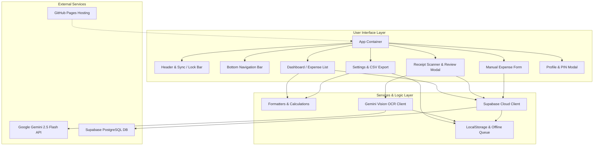

# Daily Expense Tracker (Scan & Manual Entry PWA) Implementation Plan

> **For agentic workers:** REQUIRED SUB-SKILL: Use superpowers:subagent-driven-development to implement this plan task-by-task. Steps use checkbox (`- [ ]`) syntax for tracking.

**Goal:** Membangun aplikasi web pencatat pengeluaran harian personal mobile-first (PWA) dengan fitur Scan Struk instan bertenaga AI Gemini 2.5 Flash Vision yang langsung dapat diedit, input manual cepat, otentikasi PIN 4-digit untuk 2 pengguna terpisah, penyimpanan Supabase PostgreSQL dengan antrean offline, serta deployment otomatis ke GitHub Pages.

**Architecture:** Frontend React 19 + TypeScript + Vite + Tailwind CSS dibungkus PWA Service Worker. Ekstraksi OCR menggunakan Google Gemini 2.5 Flash Vision dengan response schema JSON terstruktur langsung dari browser. Penyimpanan awan menggunakan Supabase JS client dengan isolasi kolom `user_id`, dilengkapi antrean `localStorage` saat offline dan sinkronisasi otomatis saat online.

**Architecture Diagram:**



**Tech Stack:** React 19, TypeScript, Vite, Tailwind CSS, Lucide React, `vite-plugin-pwa`, `@supabase/supabase-js`, `@google/genai`, Vitest, React Testing Library.

**Spec:** [`docs/superpowers/specs/2026-11-05-expense-tracker-design.md`](file:///c:/Users/Mallik/Documents/scanapp/docs/superpowers/specs/2026-11-05-expense-tracker-design.md)

## Global Constraints

- Node.js runtime: Node v20+ (tested on v24).
- Package manager: `npm`.
- Currency formatting: Indonesian Rupiah (`Rp XX.XXX`) with thousands separator `.` and no fractional cents.
- Date format: Standard `YYYY-MM-DD` internally; readable format `DD MMMM YYYY` in UI.
- All code files strictly typed in TypeScript (`strict: true`).
- No placeholders (`TODO`, `TBD`, dummy stubs) in any implementation step.
- Every task includes automated unit/component tests adhering to TDD.

---

### Task 1: Project Scaffolding & Configuration

**Files:**
- Create: `package.json`
- Create: `vite.config.ts`
- Create: `tsconfig.json`
- Create: `tsconfig.node.json`
- Create: `index.html`
- Create: `src/index.css`
- Create: `src/main.tsx`
- Create: `vitest.config.ts`
- Create: `src/test/setup.ts`

**Interfaces:**
- Produces: Working Vite + React 19 + TypeScript + Tailwind CSS build environment with Vitest test runner.

- [ ] **Step 1: Write `package.json` with all dependencies**

```json
{
  "name": "scanapp",
  "private": true,
  "version": "1.0.0",
  "type": "module",
  "scripts": {
    "dev": "vite",
    "build": "tsc && vite build",
    "preview": "vite preview",
    "test": "vitest",
    "test:run": "vitest run"
  },
  "dependencies": {
    "@google/genai": "^0.1.2",
    "@supabase/supabase-js": "^2.49.1",
    "clsx": "^2.1.1",
    "lucide-react": "^1.16.0",
    "react": "^19.0.0",
    "react-dom": "^19.0.0",
    "tailwind-merge": "^3.0.2"
  },
  "devDependencies": {
    "@testing-library/jest-dom": "^6.6.3",
    "@testing-library/react": "^16.2.0",
    "@types/node": "^22.13.1",
    "@types/react": "^19.0.8",
    "@types/react-dom": "^19.0.3",
    "@vitejs/plugin-react": "^4.3.4",
    "autoprefixer": "^10.4.20",
    "jsdom": "^26.0.0",
    "postcss": "^8.5.1",
    "tailwindcss": "^3.4.17",
    "typescript": "~5.7.2",
    "vite": "^6.1.0",
    "vite-plugin-pwa": "^0.21.1",
    "vitest": "^3.0.5"
  }
}
```

- [ ] **Step 2: Run `npm install` outside sandbox**

Run: `npm install`
Expected: Dependencies installed successfully, `node_modules` created.

- [ ] **Step 3: Create configuration files (`vite.config.ts`, `vitest.config.ts`, `tsconfig.json`, `tailwind.config.js`, `postcss.config.js`)**

`vite.config.ts`:
```typescript
import { defineConfig } from 'vite';
import react from '@vitejs/plugin-react';
import { VitePWA } from 'vite-plugin-pwa';

export default defineConfig({
  base: './',
  plugins: [
    react(),
    VitePWA({
      registerType: 'autoUpdate',
      includeAssets: ['favicon.svg', 'apple-touch-icon.png'],
      manifest: {
        name: 'ScanApp - Catat Pengeluaran Harian',
        short_name: 'ScanApp',
        description: 'Pencatat pengeluaran harian dengan AI OCR struk belanjaan',
        theme_color: '#4f46e5',
        background_color: '#f8fafc',
        display: 'standalone',
        icons: [
          {
            src: 'icon-192.svg',
            sizes: '192x192',
            type: 'image/svg+xml'
          },
          {
            src: 'icon-512.svg',
            sizes: '512x512',
            type: 'image/svg+xml'
          }
        ]
      }
    })
  ]
});
```

`vitest.config.ts`:
```typescript
import { defineConfig } from 'vitest/config';
import react from '@vitejs/plugin-react';

export default defineConfig({
  plugins: [react()],
  test: {
    globals: true,
    environment: 'jsdom',
    setupFiles: ['./src/test/setup.ts'],
    coverage: {
      reporter: ['text', 'json', 'html']
    }
  }
});
```

`src/test/setup.ts`:
```typescript
import '@testing-library/jest-dom';
```

`tailwind.config.js`:
```javascript
/** @type {import('tailwindcss').Config} */
export default {
  content: ['./index.html', './src/**/*.{js,ts,jsx,tsx}'],
  theme: {
    extend: {
      colors: {
        brand: {
          50: '#eef2ff',
          500: '#6366f1',
          600: '#4f46e5',
          700: '#4338ca'
        }
      }
    }
  },
  plugins: []
};
```

`postcss.config.js`:
```javascript
export default {
  plugins: {
    tailwindcss: {},
    autoprefixer: {}
  }
};
```

`tsconfig.json`:
```json
{
  "compilerOptions": {
    "target": "ES2022",
    "useDefineForClassFields": true,
    "lib": ["ES2022", "DOM", "DOM.Iterable"],
    "module": "ESNext",
    "skipLibCheck": true,
    "moduleResolution": "bundler",
    "allowImportingTsExtensions": true,
    "resolveJsonModule": true,
    "isolatedModules": true,
    "noEmit": true,
    "jsx": "react-jsx",
    "strict": true,
    "noUnusedLocals": true,
    "noUnusedParameters": true,
    "noFallthroughCasesInSwitch": true
  },
  "include": ["src"]
}
```

`index.html`:
```html
<!doctype html>
<html lang="id">
  <head>
    <meta charset="UTF-8" />
    <link rel="icon" type="image/svg+xml" href="/favicon.svg" />
    <meta name="viewport" content="width=device-width, initial-scale=1.0, maximum-scale=1.0, user-scalable=no" />
    <meta name="theme-color" content="#4f46e5" />
    <title>ScanApp - Catat Pengeluaran</title>
  </head>
  <body class="bg-slate-50 text-slate-900 antialiased selection:bg-brand-500 selection:text-white">
    <div id="root"></div>
    <script type="module" src="/src/main.tsx"></script>
  </body>
</html>
```

`src/index.css`:
```css
@tailwind base;
@tailwind components;
@tailwind utilities;

body {
  margin: 0;
  min-height: 100vh;
  touch-action: manipulation;
}
```

`src/main.tsx`:
```tsx
import React from 'react';
import ReactDOM from 'react-dom/client';
import './index.css';

ReactDOM.createRoot(document.getElementById('root')!).render(
  <React.StrictMode>
    <div className="p-4 text-center">ScanApp Initializing...</div>
  </React.StrictMode>
);
```

- [ ] **Step 4: Verify test suite runner & build**

Run: `npm run test:run`
Expected: 0 errors (empty test suite or passes).
Run: `npm run build`
Expected: TypeScript compile and Vite bundling succeed into `dist/`.

- [ ] **Step 5: Commit**

```bash
git add package.json vite.config.ts vitest.config.ts tailwind.config.js postcss.config.js tsconfig.json index.html src/
git commit -m "chore: scaffold react 19 vite tailwind pwa project"
```

---

### Task 2: Core Types & Currency / Date Formatting Utilities (TDD)

**Files:**
- Create: `src/types/index.ts`
- Create: `src/utils/formatters.ts`
- Test: `src/utils/formatters.test.ts`

**Interfaces:**
- Produces: `formatIDR(num: number): string`, `parseIDR(str: string): number`, `formatDateIndo(isoDate: string): string`, `getTodayDateString(): string`.

- [ ] **Step 1: Write `src/types/index.ts`**

```typescript
export interface ReceiptItem {
  name: string;
  quantity: number;
  price: number;
}

export type ExpenseCategory =
  | 'Makanan & Minuman'
  | 'Belanja Harian'
  | 'Transportasi & Bensin'
  | 'Tagihan & Utilitas'
  | 'Hiburan & Hobi'
  | 'Kesehatan'
  | 'Lainnya';

export interface Expense {
  id: string;
  user_id: string;
  title: string;
  amount: number;
  category: ExpenseCategory;
  date: string; // YYYY-MM-DD
  receipt_items?: ReceiptItem[] | null;
  notes?: string | null;
  created_at: string;
  synced?: boolean;
}

export interface UserProfile {
  id: 'user_1' | 'user_2';
  name: string;
  pin: string;
}

export interface GeminiReceiptResponse {
  merchantName: string;
  date: string;
  category: string;
  items: Array<{
    name: string;
    quantity: number;
    price: number;
  }>;
  totalAmount: number;
  confidenceNotes?: string;
}

export type DateFilter = 'today' | 'week' | 'month' | 'all';
```

- [ ] **Step 2: Write failing unit tests for formatters**

`src/utils/formatters.test.ts`:
```typescript
import { describe, it, expect } from 'vitest';
import { formatIDR, parseIDR, formatDateIndo, getTodayDateString } from './formatters';

describe('formatters', () => {
  it('formats number to Indonesian Rupiah with thousands separator', () => {
    expect(formatIDR(0)).toBe('Rp 0');
    expect(formatIDR(15000)).toBe('Rp 15.000');
    expect(formatIDR(1250000)).toBe('Rp 1.250.000');
    expect(formatIDR(48500.75)).toBe('Rp 48.501');
  });

  it('parses raw or formatted IDR strings into clean numbers', () => {
    expect(parseIDR('Rp 15.000')).toBe(15000);
    expect(parseIDR('15000')).toBe(15000);
    expect(parseIDR('Rp 1.250.500')).toBe(1250500);
    expect(parseIDR('')).toBe(0);
    expect(parseIDR('abc')).toBe(0);
  });

  it('formats ISO date to human readable Indonesian date', () => {
    expect(formatDateIndo('2026-11-05')).toBe('5 November 2026');
    expect(formatDateIndo('2026-01-01')).toBe('1 Januari 2026');
    expect(formatDateIndo('invalid-date')).toBe('invalid-date');
  });

  it('returns today date string in YYYY-MM-DD format', () => {
    const today = getTodayDateString();
    expect(today).toMatch(/^\d{4}-\d{2}-\d{2}$/);
  });
});
```

- [ ] **Step 3: Run test to verify it fails**

Run: `npx vitest run src/utils/formatters.test.ts`
Expected: FAIL (Cannot find module `./formatters`).

- [ ] **Step 4: Implement `src/utils/formatters.ts`**

```typescript
export function formatIDR(amount: number): string {
  if (isNaN(amount)) return 'Rp 0';
  const rounded = Math.round(amount);
  return 'Rp ' + rounded.toString().replace(/\B(?=(\d{3})+(?!\d))/g, '.');
}

export function parseIDR(str: string): number {
  if (!str) return 0;
  const cleaned = str.replace(/[^\d]/g, '');
  const parsed = parseInt(cleaned, 10);
  return isNaN(parsed) ? 0 : parsed;
}

const MONTH_NAMES_ID = [
  'Januari', 'Februari', 'Maret', 'April', 'Mei', 'Juni',
  'Juli', 'Agustus', 'September', 'Oktober', 'November', 'Desember'
];

export function formatDateIndo(dateStr: string): string {
  if (!dateStr || !dateStr.includes('-')) return dateStr;
  const parts = dateStr.split('-');
  if (parts.length !== 3) return dateStr;

  const year = parseInt(parts[0], 10);
  const month = parseInt(parts[1], 10) - 1;
  const day = parseInt(parts[2], 10);

  if (isNaN(year) || isNaN(month) || isNaN(day) || month < 0 || month > 11) {
    return dateStr;
  }

  return `${day} ${MONTH_NAMES_ID[month]} ${year}`;
}

export function getTodayDateString(): string {
  const now = new Date();
  const year = now.getFullYear();
  const month = String(now.getMonth() + 1).padStart(2, '0');
  const day = String(now.getDate()).padStart(2, '0');
  return `${year}-${month}-${day}`;
}
```

- [ ] **Step 5: Run test to verify it passes**

Run: `npx vitest run src/utils/formatters.test.ts`
Expected: PASS (4 tests passed).

- [ ] **Step 6: Commit**

```bash
git add src/types/index.ts src/utils/formatters.ts src/utils/formatters.test.ts
git commit -m "feat(utils): add types and rupiah date formatters with unit tests"
```

---

### Task 3: Aggregation & Calculation Utilities (TDD)

**Files:**
- Create: `src/utils/calculations.ts`
- Test: `src/utils/calculations.test.ts`

**Interfaces:**
- Produces: `calculateTotalExpense`, `filterExpensesByDateRange`, `calculateCategoryBreakdown`.

- [ ] **Step 1: Write failing unit test**

`src/utils/calculations.test.ts`:
```typescript
import { describe, it, expect } from 'vitest';
import { calculateTotalExpense, filterExpensesByDateRange, calculateCategoryBreakdown } from './calculations';
import { Expense } from '../types';

const mockExpenses: Expense[] = [
  {
    id: '1',
    user_id: 'user_1',
    title: 'Makan Pagi',
    amount: 25000,
    category: 'Makanan & Minuman',
    date: '2026-11-05',
    created_at: '2026-11-05T08:00:00Z'
  },
  {
    id: '2',
    user_id: 'user_1',
    title: 'Bensin Motor',
    amount: 50000,
    category: 'Transportasi & Bensin',
    date: '2026-11-05',
    created_at: '2026-11-05T09:00:00Z'
  },
  {
    id: '3',
    user_id: 'user_1',
    title: 'Supermarket',
    amount: 150000,
    category: 'Belanja Harian',
    date: '2026-11-01',
    created_at: '2026-11-01T12:00:00Z'
  }
];

describe('calculations', () => {
  it('calculates total expense amount correctly', () => {
    expect(calculateTotalExpense([])).toBe(0);
    expect(calculateTotalExpense(mockExpenses)).toBe(225000);
  });

  it('filters expenses by today date', () => {
    const todayExpenses = filterExpensesByDateRange(mockExpenses, 'today', '2026-11-05');
    expect(todayExpenses).toHaveLength(2);
    expect(todayExpenses.map(e => e.id)).toEqual(['1', '2']);
  });

  it('filters expenses by month', () => {
    const monthExpenses = filterExpensesByDateRange(mockExpenses, 'month', '2026-11-05');
    expect(monthExpenses).toHaveLength(3);
  });

  it('aggregates category breakdown with totals and percentages', () => {
    const breakdown = calculateCategoryBreakdown(mockExpenses);
    expect(breakdown).toHaveLength(3);
    const belanja = breakdown.find(b => b.category === 'Belanja Harian');
    expect(belanja).toBeDefined();
    expect(belanja?.total).toBe(150000);
    expect(belanja?.count).toBe(1);
    expect(belanja?.percentage).toBe(67); // 150000 / 225000 = 66.67 -> 67%
  });
});
```

- [ ] **Step 2: Run test to verify it fails**

Run: `npx vitest run src/utils/calculations.test.ts`
Expected: FAIL (Cannot find module `./calculations`).

- [ ] **Step 3: Implement `src/utils/calculations.ts`**

```typescript
import { Expense, DateFilter, ExpenseCategory } from '../types';

export interface CategoryBreakdown {
  category: ExpenseCategory;
  total: number;
  count: number;
  percentage: number;
}

export function calculateTotalExpense(expenses: Expense[]): number {
  return expenses.reduce((acc, curr) => acc + (Number(curr.amount) || 0), 0);
}

export function filterExpensesByDateRange(
  expenses: Expense[],
  filter: DateFilter,
  referenceDateStr: string = new Date().toISOString().split('T')[0]
): Expense[] {
  if (filter === 'all') return expenses;

  const [refYear, refMonth, refDay] = referenceDateStr.split('-').map(Number);
  const refDate = new Date(refYear, refMonth - 1, refDay);

  return expenses.filter(item => {
    if (!item.date) return false;
    const [y, m, d] = item.date.split('-').map(Number);
    const itemDate = new Date(y, m - 1, d);

    if (filter === 'today') {
      return item.date === referenceDateStr;
    }

    if (filter === 'week') {
      const diffTime = refDate.getTime() - itemDate.getTime();
      const diffDays = diffTime / (1000 * 3600 * 24);
      return diffDays >= 0 && diffDays <= 7;
    }

    if (filter === 'month') {
      return y === refYear && m === refMonth;
    }

    return true;
  });
}

export function calculateCategoryBreakdown(expenses: Expense[]): CategoryBreakdown[] {
  const total = calculateTotalExpense(expenses);
  const map = new Map<ExpenseCategory, { total: number; count: number }>();

  for (const exp of expenses) {
    const existing = map.get(exp.category) || { total: 0, count: 0 };
    existing.total += Number(exp.amount) || 0;
    existing.count += 1;
    map.set(exp.category, existing);
  }

  const result: CategoryBreakdown[] = [];
  for (const [category, data] of map.entries()) {
    result.push({
      category,
      total: data.total,
      count: data.count,
      percentage: total > 0 ? Math.round((data.total / total) * 100) : 0
    });
  }

  return result.sort((a, b) => b.total - a.total);
}
```

- [ ] **Step 4: Run test to verify it passes**

Run: `npx vitest run src/utils/calculations.test.ts`
Expected: PASS (4 tests passed).

- [ ] **Step 5: Commit**

```bash
git add src/utils/calculations.ts src/utils/calculations.test.ts
git commit -m "feat(utils): add expense total, filter, and category calculations"
```

---

### Task 4: Storage & Offline Queue Service (TDD)

**Files:**
- Create: `src/services/storage.ts`
- Test: `src/services/storage.test.ts`

**Interfaces:**
- Produces: API Key persistence, active user & PIN management, and offline queue mechanism for when internet connection drops.

- [ ] **Step 1: Write failing unit test**

`src/services/storage.test.ts`:
```typescript
import { describe, it, expect, beforeEach } from 'vitest';
import {
  getStoredApiKey,
  setStoredApiKey,
  getActiveUser,
  setActiveUser,
  getStoredPin,
  setStoredPin,
  getOfflineQueue,
  enqueueOfflineExpense,
  clearOfflineQueue
} from './storage';
import { Expense } from '../types';

describe('storage service', () => {
  beforeEach(() => {
    localStorage.clear();
  });

  it('stores and retrieves Gemini API Key', () => {
    expect(getStoredApiKey()).toBe('');
    setStoredApiKey('AIzaSyTestKey123');
    expect(getStoredApiKey()).toBe('AIzaSyTestKey123');
  });

  it('manages active user ID and PIN per user', () => {
    expect(getActiveUser()).toBe('user_1'); // default
    setActiveUser('user_2');
    expect(getActiveUser()).toBe('user_2');

    // Default pin is 1234
    expect(getStoredPin('user_1')).toBe('1234');
    setStoredPin('user_1', '5678');
    expect(getStoredPin('user_1')).toBe('5678');
    expect(getStoredPin('user_2')).toBe('1234'); // unmodified
  });

  it('enqueues and clears offline expenses queue', () => {
    expect(getOfflineQueue()).toEqual([]);
    const item: Expense = {
      id: 'offline-1',
      user_id: 'user_1',
      title: 'Makan Offline',
      amount: 20000,
      category: 'Makanan & Minuman',
      date: '2026-11-05',
      created_at: new Date().toISOString()
    };
    enqueueOfflineExpense(item);
    expect(getOfflineQueue()).toHaveLength(1);
    expect(getOfflineQueue()[0].id).toBe('offline-1');

    clearOfflineQueue();
    expect(getOfflineQueue()).toEqual([]);
  });
});
```

- [ ] **Step 2: Run test to verify it fails**

Run: `npx vitest run src/services/storage.test.ts`
Expected: FAIL.

- [ ] **Step 3: Implement `src/services/storage.ts`**

```typescript
import { Expense } from '../types';

const STORAGE_KEYS = {
  GEMINI_API_KEY: 'scanapp_gemini_api_key',
  ACTIVE_USER: 'scanapp_active_user',
  PIN_PREFIX: 'scanapp_pin_',
  OFFLINE_QUEUE: 'scanapp_offline_queue',
  SUPABASE_URL: 'scanapp_supabase_url',
  SUPABASE_KEY: 'scanapp_supabase_key'
};

export function getStoredApiKey(): string {
  return localStorage.getItem(STORAGE_KEYS.GEMINI_API_KEY) || '';
}

export function setStoredApiKey(key: string): void {
  localStorage.setItem(STORAGE_KEYS.GEMINI_API_KEY, key.trim());
}

export function getActiveUser(): 'user_1' | 'user_2' {
  const u = localStorage.getItem(STORAGE_KEYS.ACTIVE_USER);
  return u === 'user_2' ? 'user_2' : 'user_1';
}

export function setActiveUser(user: 'user_1' | 'user_2'): void {
  localStorage.setItem(STORAGE_KEYS.ACTIVE_USER, user);
}

export function getStoredPin(user: 'user_1' | 'user_2'): string {
  return localStorage.getItem(STORAGE_KEYS.PIN_PREFIX + user) || '1234';
}

export function setStoredPin(user: 'user_1' | 'user_2', pin: string): void {
  localStorage.setItem(STORAGE_KEYS.PIN_PREFIX + user, pin);
}

export function getOfflineQueue(): Expense[] {
  try {
    const raw = localStorage.getItem(STORAGE_KEYS.OFFLINE_QUEUE);
    return raw ? JSON.parse(raw) : [];
  } catch {
    return [];
  }
}

export function enqueueOfflineExpense(expense: Expense): void {
  const queue = getOfflineQueue();
  queue.push({ ...expense, synced: false });
  localStorage.setItem(STORAGE_KEYS.OFFLINE_QUEUE, JSON.stringify(queue));
}

export function clearOfflineQueue(): void {
  localStorage.removeItem(STORAGE_KEYS.OFFLINE_QUEUE);
}

export function getStoredSupabaseConfig(): { url: string; key: string } {
  return {
    url: localStorage.getItem(STORAGE_KEYS.SUPABASE_URL) || '',
    key: localStorage.getItem(STORAGE_KEYS.SUPABASE_KEY) || ''
  };
}

export function setStoredSupabaseConfig(url: string, key: string): void {
  localStorage.setItem(STORAGE_KEYS.SUPABASE_URL, url.trim());
  localStorage.setItem(STORAGE_KEYS.SUPABASE_KEY, key.trim());
}
```

- [ ] **Step 4: Run test to verify it passes**

Run: `npx vitest run src/services/storage.test.ts`
Expected: PASS (3 tests passed).

- [ ] **Step 5: Commit**

```bash
git add src/services/storage.ts src/services/storage.test.ts
git commit -m "feat(services): implement storage and offline queue service with tests"
```

---

### Task 5: Gemini Receipt OCR Parser Service (TDD)

**Files:**
- Create: `src/services/gemini.ts`
- Test: `src/services/gemini.test.ts`

**Interfaces:**
- Produces: `parseGeminiReceiptJson(rawJsonText: string): GeminiReceiptResponse`, `buildReceiptPrompt()`, and `extractReceiptWithGemini(...)`.

- [ ] **Step 1: Write failing unit test**

`src/services/gemini.test.ts`:
```typescript
import { describe, it, expect } from 'vitest';
import { parseGeminiReceiptJson } from './gemini';

describe('gemini service parser', () => {
  it('parses valid json directly', () => {
    const jsonString = JSON.stringify({
      merchantName: 'Indomaret Kemang',
      date: '2026-11-05',
      category: 'Belanja Harian',
      items: [
        { name: 'Susu UHT', quantity: 2, price: 18000 },
        { name: 'Roti Gandum', quantity: 1, price: 15000 }
      ],
      totalAmount: 33000
    });

    const parsed = parseGeminiReceiptJson(jsonString);
    expect(parsed.merchantName).toBe('Indomaret Kemang');
    expect(parsed.totalAmount).toBe(33000);
    expect(parsed.items).toHaveLength(2);
  });

  it('strips markdown code blocks (```json ... ```) before parsing', () => {
    const rawMarkdown = `\`\`\`json
    {
      "merchantName": "Alfamart",
      "date": "2026-11-04",
      "category": "Belanja Harian",
      "items": [],
      "totalAmount": 25000
    }
    \`\`\``;

    const parsed = parseGeminiReceiptJson(rawMarkdown);
    expect(parsed.merchantName).toBe('Alfamart');
    expect(parsed.totalAmount).toBe(25000);
  });

  it('provides safe fallbacks for missing or malformed fields', () => {
    const incompleteJson = '{"totalAmount": 50000}';
    const parsed = parseGeminiReceiptJson(incompleteJson);
    expect(parsed.merchantName).toBe('Struk Pembelian');
    expect(parsed.totalAmount).toBe(50000);
    expect(parsed.category).toBe('Belanja Harian');
    expect(parsed.items).toEqual([]);
  });

  it('throws a descriptive error on non-json text', () => {
    expect(() => parseGeminiReceiptJson('not a json at all')).toThrow('Gagal mengurai data struk');
  });
});
```

- [ ] **Step 2: Run test to verify it fails**

Run: `npx vitest run src/services/gemini.test.ts`
Expected: FAIL.

- [ ] **Step 3: Implement `src/services/gemini.ts`**

```typescript
import { GeminiReceiptResponse } from '../types';
import { getTodayDateString } from '../utils/formatters';

export function parseGeminiReceiptJson(rawText: string): GeminiReceiptResponse {
  let cleaned = rawText.trim();
  // Strip markdown code fences if present
  cleaned = cleaned.replace(/^```json\s*/i, '').replace(/```\s*$/, '').trim();

  let parsed: any;
  try {
    parsed = JSON.parse(cleaned);
  } catch (err) {
    throw new Error('Gagal mengurai data struk dari AI. Gambar mungkin buram atau tidak berisi struk.');
  }

  const items = Array.isArray(parsed.items)
    ? parsed.items.map((it: any) => ({
        name: String(it.name || 'Barang'),
        quantity: Number(it.quantity) || 1,
        price: Number(it.price) || 0
      }))
    : [];

  return {
    merchantName: String(parsed.merchantName || 'Struk Pembelian'),
    date: parsed.date && parsed.date.match(/^\d{4}-\d{2}-\d{2}$/) ? parsed.date : getTodayDateString(),
    category: String(parsed.category || 'Belanja Harian'),
    items,
    totalAmount: Number(parsed.totalAmount) || items.reduce((acc, it) => acc + it.price, 0),
    confidenceNotes: parsed.confidenceNotes ? String(parsed.confidenceNotes) : undefined
  };
}

export const RECEIPT_SCHEMA_INSTRUCTION = `
Ekstrak rincian struk belanja ini ke dalam format JSON yang valid dan terstruktur persis seperti skema ini:
{
  "merchantName": "Nama Toko atau Tempat Makan",
  "date": "YYYY-MM-DD",
  "category": "Makanan & Minuman | Belanja Harian | Transportasi & Bensin | Tagihan & Utilitas | Hiburan & Hobi | Kesehatan | Lainnya",
  "items": [
    { "name": "Nama Produk", "quantity": 1, "price": 10000 }
  ],
  "totalAmount": 10000,
  "confidenceNotes": "Catatan singkat jika ada teks yang buram"
}
Jangan tambahkan teks pengantar apapun di luar JSON murni.
`;

export async function extractReceiptWithGemini(
  apiKey: string,
  imageBase64: string,
  mimeType: string = 'image/jpeg'
): Promise<GeminiReceiptResponse> {
  if (!apiKey) {
    throw new Error('Kunci API Gemini belum diatur. Silakan masukkan di menu Setelan.');
  }

  const endpoint = `https://generativelanguage.googleapis.com/v1beta/models/gemini-2.5-flash:generateContent?key=${apiKey}`;

  const payload = {
    contents: [
      {
        parts: [
          {
            text: RECEIPT_SCHEMA_INSTRUCTION
          },
          {
            inline_data: {
              mime_type: mimeType,
              data: imageBase64
            }
          }
        ]
      }
    ],
    generationConfig: {
      temperature: 0.1,
      response_mime_type: 'application/json'
    }
  };

  const response = await fetch(endpoint, {
    method: 'POST',
    headers: { 'Content-Type': 'application/json' },
    body: JSON.stringify(payload)
  });

  if (!response.ok) {
    const errorData = await response.json().catch(() => ({}));
    throw new Error(errorData.error?.message || `Gagal menghubungi Gemini API (Status ${response.status})`);
  }

  const data = await response.json();
  const rawText = data.candidates?.[0]?.content?.parts?.[0]?.text;
  if (!rawText) {
    throw new Error('AI tidak mengembalikan respon teks dari gambar struk.');
  }

  return parseGeminiReceiptJson(rawText);
}
```

- [ ] **Step 4: Run test to verify it passes**

Run: `npx vitest run src/services/gemini.test.ts`
Expected: PASS (4 tests passed).

- [ ] **Step 5: Commit**

```bash
git add src/services/gemini.ts src/services/gemini.test.ts
git commit -m "feat(services): implement gemini vision ocr service and robust json parser"
```

---

### Task 6: Supabase Client & CRUD Service (TDD)

**Files:**
- Create: `src/services/supabase.ts`
- Test: `src/services/supabase.test.ts`

**Interfaces:**
- Produces: `getExpenses(userId: string)`, `createExpense(expense: Expense)`, `removeExpense(id: string)`, `syncOfflineExpenses()`.

- [ ] **Step 1: Write failing unit test with mocks**

`src/services/supabase.test.ts`:
```typescript
import { describe, it, expect, vi, beforeEach } from 'vitest';
import { isSupabaseConfigured, createExpenseLocallyOrCloud } from './supabase';
import { Expense } from '../types';
import * as storage from './storage';

describe('supabase service', () => {
  beforeEach(() => {
    localStorage.clear();
    vi.restoreAllMocks();
  });

  it('checks if supabase is configured', () => {
    expect(isSupabaseConfigured()).toBe(false);
    storage.setStoredSupabaseConfig('https://xyz.supabase.co', 'anon-key-123');
    expect(isSupabaseConfigured()).toBe(true);
  });

  it('saves to offline queue when supabase is not configured', async () => {
    const expense: Expense = {
      id: 'exp-1',
      user_id: 'user_1',
      title: 'Makan Bakso',
      amount: 25000,
      category: 'Makanan & Minuman',
      date: '2026-11-05',
      created_at: new Date().toISOString()
    };

    const result = await createExpenseLocallyOrCloud(expense);
    expect(result.synced).toBe(false);
    expect(storage.getOfflineQueue()).toHaveLength(1);
  });
});
```

- [ ] **Step 2: Run test to verify it fails**

Run: `npx vitest run src/services/supabase.test.ts`
Expected: FAIL.

- [ ] **Step 3: Implement `src/services/supabase.ts`**

```typescript
import { createClient, SupabaseClient } from '@supabase/supabase-js';
import { Expense } from '../types';
import { getStoredSupabaseConfig, getOfflineQueue, enqueueOfflineExpense, clearOfflineQueue } from './storage';

let cachedClient: SupabaseClient | null = null;
let lastUrl = '';
let lastKey = '';

export function isSupabaseConfigured(): boolean {
  const { url, key } = getStoredSupabaseConfig();
  return Boolean(url && key);
}

export function getSupabaseClient(): SupabaseClient | null {
  const { url, key } = getStoredSupabaseConfig();
  if (!url || !key) return null;

  if (cachedClient && lastUrl === url && lastKey === key) {
    return cachedClient;
  }

  try {
    cachedClient = createClient(url, key);
    lastUrl = url;
    lastKey = key;
    return cachedClient;
  } catch {
    return null;
  }
}

export async function fetchExpensesFromCloud(userId: string): Promise<Expense[]> {
  const client = getSupabaseClient();
  if (!client) return [];

  const { data, error } = await client
    .from('expenses')
    .select('*')
    .eq('user_id', userId)
    .order('date', { ascending: false });

  if (error) {
    console.warn('Supabase fetch error:', error.message);
    return [];
  }

  return (data || []).map((row: any) => ({
    ...row,
    synced: true
  }));
}

export async function createExpenseLocallyOrCloud(expense: Expense): Promise<Expense> {
  const client = getSupabaseClient();

  if (!client || !navigator.onLine) {
    enqueueOfflineExpense(expense);
    return { ...expense, synced: false };
  }

  try {
    const { error } = await client.from('expenses').insert([
      {
        id: expense.id,
        user_id: expense.user_id,
        title: expense.title,
        amount: expense.amount,
        category: expense.category,
        date: expense.date,
        receipt_items: expense.receipt_items || null,
        notes: expense.notes || null,
        created_at: expense.created_at
      }
    ]);

    if (error) {
      console.warn('Supabase insert failed, saving to offline queue:', error.message);
      enqueueOfflineExpense(expense);
      return { ...expense, synced: false };
    }

    return { ...expense, synced: true };
  } catch (err) {
    enqueueOfflineExpense(expense);
    return { ...expense, synced: false };
  }
}

export async function deleteExpenseFromCloud(id: string): Promise<boolean> {
  const client = getSupabaseClient();
  if (!client) return true;

  const { error } = await client.from('expenses').delete().eq('id', id);
  return !error;
}

export async function syncOfflineQueueToCloud(): Promise<number> {
  const client = getSupabaseClient();
  if (!client || !navigator.onLine) return 0;

  const queue = getOfflineQueue();
  if (queue.length === 0) return 0;

  let successCount = 0;
  const remaining: Expense[] = [];

  for (const item of queue) {
    const { error } = await client.from('expenses').upsert([
      {
        id: item.id,
        user_id: item.user_id,
        title: item.title,
        amount: item.amount,
        category: item.category,
        date: item.date,
        receipt_items: item.receipt_items || null,
        notes: item.notes || null,
        created_at: item.created_at
      }
    ]);

    if (!error) {
      successCount++;
    } else {
      remaining.push(item);
    }
  }

  if (remaining.length === 0) {
    clearOfflineQueue();
  } else {
    localStorage.setItem('scanapp_offline_queue', JSON.stringify(remaining));
  }

  return successCount;
}
```

- [ ] **Step 4: Run test to verify it passes**

Run: `npx vitest run src/services/supabase.test.ts`
Expected: PASS (2 tests passed).

- [ ] **Step 5: Commit**

```bash
git add src/services/supabase.ts src/services/supabase.test.ts
git commit -m "feat(services): implement supabase client with offline queue sync fallback"
```

---

### Task 7: Auth & PIN Protection Components (TDD)

**Files:**
- Create: `src/components/auth/ProfilePinModal.tsx`
- Test: `src/components/auth/ProfilePinModal.test.tsx`

**Interfaces:**
- Produces: `ProfilePinModal` component with user selector (`User 1` vs `User 2`), 4-digit PIN input pad, validation, and unlock callback.

- [ ] **Step 1: Write failing component test**

`src/components/auth/ProfilePinModal.test.tsx`:
```tsx
import React from 'react';
import { describe, it, expect, vi } from 'vitest';
import { render, screen, fireEvent } from '@testing-library/react';
import { ProfilePinModal } from './ProfilePinModal';

describe('ProfilePinModal', () => {
  it('renders user switcher and 4-digit PIN input pad', () => {
    render(<ProfilePinModal activeUser="user_1" onUnlock={vi.fn()} onSwitchUser={vi.fn()} />);
    expect(screen.getByText('Buka Kunci Akun')).toBeInTheDocument();
    expect(screen.getByRole('button', { name: /User 1/i })).toBeInTheDocument();
    expect(screen.getByRole('button', { name: /User 2/i })).toBeInTheDocument();
  });

  it('triggers onUnlock when correct PIN (1234) is entered', () => {
    const handleUnlock = vi.fn();
    render(<ProfilePinModal activeUser="user_1" onUnlock={handleUnlock} onSwitchUser={vi.fn()} />);

    // Click digits 1, 2, 3, 4
    fireEvent.click(screen.getByRole('button', { name: '1' }));
    fireEvent.click(screen.getByRole('button', { name: '2' }));
    fireEvent.click(screen.getByRole('button', { name: '3' }));
    fireEvent.click(screen.getByRole('button', { name: '4' }));

    expect(handleUnlock).toHaveBeenCalledTimes(1);
  });

  it('shows error message when incorrect PIN is entered', () => {
    const handleUnlock = vi.fn();
    render(<ProfilePinModal activeUser="user_1" onUnlock={handleUnlock} onSwitchUser={vi.fn()} />);

    // Enter wrong PIN: 9, 9, 9, 9
    fireEvent.click(screen.getByRole('button', { name: '9' }));
    fireEvent.click(screen.getByRole('button', { name: '9' }));
    fireEvent.click(screen.getByRole('button', { name: '9' }));
    fireEvent.click(screen.getByRole('button', { name: '9' }));

    expect(handleUnlock).not.toHaveBeenCalled();
    expect(screen.getByText(/PIN salah/i)).toBeInTheDocument();
  });
});
```

- [ ] **Step 2: Run test to verify it fails**

Run: `npx vitest run src/components/auth/ProfilePinModal.test.tsx`
Expected: FAIL.

- [ ] **Step 3: Implement `src/components/auth/ProfilePinModal.tsx`**

```tsx
import React, { useState } from 'react';
import { Lock, Delete } from 'lucide-react';
import { getStoredPin } from '../../services/storage';

interface ProfilePinModalProps {
  activeUser: 'user_1' | 'user_2';
  onUnlock: () => void;
  onSwitchUser: (newUser: 'user_1' | 'user_2') => void;
}

export const ProfilePinModal: React.FC<ProfilePinModalProps> = ({
  activeUser,
  onUnlock,
  onSwitchUser
}) => {
  const [pin, setPin] = useState('');
  const [errorMessage, setErrorMessage] = useState('');

  const correctPin = getStoredPin(activeUser);

  const handleDigit = (digit: string) => {
    if (pin.length >= 4) return;
    const nextPin = pin + digit;
    setPin(nextPin);
    setErrorMessage('');

    if (nextPin.length === 4) {
      if (nextPin === correctPin) {
        onUnlock();
      } else {
        setErrorMessage('PIN salah, silakan coba lagi');
        setTimeout(() => setPin(''), 500);
      }
    }
  };

  const handleDelete = () => {
    setPin(prev => prev.slice(0, -1));
    setErrorMessage('');
  };

  return (
    <div className="fixed inset-0 z-50 flex items-center justify-center bg-slate-900/80 p-4 backdrop-blur-sm">
      <div className="w-full max-w-sm rounded-3xl bg-white p-6 shadow-2xl text-center">
        <div className="mx-auto mb-4 flex h-14 w-14 items-center justify-center rounded-2xl bg-brand-50 text-brand-600">
          <Lock className="h-7 w-7" />
        </div>

        <h2 className="text-xl font-bold text-slate-800">Buka Kunci Akun</h2>
        <p className="mt-1 text-xs text-slate-500">Pilih akun dan masukkan 4-digit PIN Anda</p>

        {/* User Switcher */}
        <div className="my-5 flex rounded-xl bg-slate-100 p-1">
          <button
            type="button"
            onClick={() => {
              setPin('');
              setErrorMessage('');
              onSwitchUser('user_1');
            }}
            className={`flex-1 rounded-lg py-2 text-sm font-semibold transition ${
              activeUser === 'user_1' ? 'bg-white text-brand-600 shadow' : 'text-slate-500'
            }`}
          >
            User 1
          </button>
          <button
            type="button"
            onClick={() => {
              setPin('');
              setErrorMessage('');
              onSwitchUser('user_2');
            }}
            className={`flex-1 rounded-lg py-2 text-sm font-semibold transition ${
              activeUser === 'user_2' ? 'bg-white text-brand-600 shadow' : 'text-slate-500'
            }`}
          >
            User 2
          </button>
        </div>

        {/* PIN Indicators */}
        <div className="my-6 flex justify-center gap-3">
          {[0, 1, 2, 3].map(idx => (
            <div
              key={idx}
              className={`h-4 w-4 rounded-full border-2 transition-all ${
                idx < pin.length
                  ? 'border-brand-600 bg-brand-600 scale-110'
                  : 'border-slate-300 bg-transparent'
              }`}
            />
          ))}
        </div>

        {errorMessage && (
          <p className="mb-4 text-xs font-semibold text-rose-500 animate-pulse">{errorMessage}</p>
        )}

        {/* Numeric Keypad */}
        <div className="grid grid-cols-3 gap-3">
          {['1', '2', '3', '4', '5', '6', '7', '8', '9'].map(digit => (
            <button
              key={digit}
              type="button"
              onClick={() => handleDigit(digit)}
              className="flex h-14 items-center justify-center rounded-2xl bg-slate-50 text-xl font-bold text-slate-700 active:bg-slate-200 transition"
            >
              {digit}
            </button>
          ))}
          <div />
          <button
            type="button"
            onClick={() => handleDigit('0')}
            className="flex h-14 items-center justify-center rounded-2xl bg-slate-50 text-xl font-bold text-slate-700 active:bg-slate-200 transition"
          >
            0
          </button>
          <button
            type="button"
            onClick={handleDelete}
            className="flex h-14 items-center justify-center rounded-2xl bg-slate-50 text-slate-500 active:bg-slate-200 transition"
          >
            <Delete className="h-6 w-6" />
          </button>
        </div>
      </div>
    </div>
  );
};
```

- [ ] **Step 4: Run test to verify it passes**

Run: `npx vitest run src/components/auth/ProfilePinModal.test.tsx`
Expected: PASS (3 tests passed).

- [ ] **Step 5: Commit**

```bash
git add src/components/auth/ProfilePinModal.tsx src/components/auth/ProfilePinModal.test.tsx
git commit -m "feat(auth): implement 4-digit PIN authentication modal with tests"
```

---

### Task 8: Manual Expense Input Form Component (TDD)

**Files:**
- Create: `src/components/manual/ManualExpenseForm.tsx`
- Test: `src/components/manual/ManualExpenseForm.test.tsx`

**Interfaces:**
- Produces: `ManualExpenseForm` with title, formatted Rupiah amount input, category picker pills, date picker, notes, and submit action.

- [ ] **Step 1: Write failing component test**

`src/components/manual/ManualExpenseForm.test.tsx`:
```tsx
import React from 'react';
import { describe, it, expect, vi } from 'vitest';
import { render, screen, fireEvent } from '@testing-library/react';
import { ManualExpenseForm } from './ManualExpenseForm';

describe('ManualExpenseForm', () => {
  it('renders all form fields and submits valid expense', () => {
    const handleSave = vi.fn();
    render(<ManualExpenseForm activeUser="user_1" onSave={handleSave} />);

    expect(screen.getByPlaceholderText(/contoh: indomaret/i)).toBeInTheDocument();
    expect(screen.getByPlaceholderText(/nominal/i)).toBeInTheDocument();

    // Fill form
    fireEvent.change(screen.getByPlaceholderText(/contoh: indomaret/i), {
      target: { value: 'Kopi Kenangan' }
    });
    fireEvent.change(screen.getByPlaceholderText(/nominal/i), {
      target: { value: '25000' }
    });

    // Submit
    fireEvent.click(screen.getByRole('button', { name: /simpan pengeluaran/i }));

    expect(handleSave).toHaveBeenCalledTimes(1);
    const savedExpense = handleSave.mock.calls[0][0];
    expect(savedExpense.title).toBe('Kopi Kenangan');
    expect(savedExpense.amount).toBe(25000);
    expect(savedExpense.user_id).toBe('user_1');
  });

  it('prevents submission when title or amount is missing', () => {
    const handleSave = vi.fn();
    render(<ManualExpenseForm activeUser="user_1" onSave={handleSave} />);

    fireEvent.click(screen.getByRole('button', { name: /simpan pengeluaran/i }));
    expect(handleSave).not.toHaveBeenCalled();
    expect(screen.getByText(/mohon isi nama pengeluaran dan nominal/i)).toBeInTheDocument();
  });
});
```

- [ ] **Step 2: Run test to verify it fails**

Run: `npx vitest run src/components/manual/ManualExpenseForm.test.tsx`
Expected: FAIL.

- [ ] **Step 3: Implement `src/components/manual/ManualExpenseForm.tsx`**

```tsx
import React, { useState } from 'react';
import { Expense, ExpenseCategory } from '../../types';
import { getTodayDateString, parseIDR, formatIDR } from '../../utils/formatters';
import { PlusCircle, Utensils, ShoppingBag, Car, Receipt, Gamepad2, HeartPulse, MoreHorizontal } from 'lucide-react';

interface ManualExpenseFormProps {
  activeUser: 'user_1' | 'user_2';
  onSave: (expense: Expense) => void;
}

const CATEGORIES: { label: ExpenseCategory; icon: any }[] = [
  { label: 'Makanan & Minuman', icon: Utensils },
  { label: 'Belanja Harian', icon: ShoppingBag },
  { label: 'Transportasi & Bensin', icon: Car },
  { label: 'Tagihan & Utilitas', icon: Receipt },
  { label: 'Hiburan & Hobi', icon: Gamepad2 },
  { label: 'Kesehatan', icon: HeartPulse },
  { label: 'Lainnya', icon: MoreHorizontal }
];

export const ManualExpenseForm: React.FC<ManualExpenseFormProps> = ({ activeUser, onSave }) => {
  const [title, setTitle] = useState('');
  const [rawAmount, setRawAmount] = useState('');
  const [category, setCategory] = useState<ExpenseCategory>('Makanan & Minuman');
  const [date, setDate] = useState(getTodayDateString());
  const [notes, setNotes] = useState('');
  const [error, setError] = useState('');

  const handleAmountChange = (e: React.ChangeEvent<HTMLInputElement>) => {
    const val = e.target.value.replace(/[^\d]/g, '');
    setRawAmount(val ? formatIDR(parseInt(val, 10)) : '');
    setError('');
  };

  const handleSubmit = (e: React.FormEvent) => {
    e.preventDefault();
    const amount = parseIDR(rawAmount);

    if (!title.trim() || amount <= 0) {
      setError('Mohon isi nama pengeluaran dan nominal dengan benar.');
      return;
    }

    const newExpense: Expense = {
      id: crypto.randomUUID ? crypto.randomUUID() : 'exp-' + Date.now(),
      user_id: activeUser,
      title: title.trim(),
      amount,
      category,
      date,
      notes: notes.trim() || null,
      created_at: new Date().toISOString()
    };

    onSave(newExpense);

    // Reset form
    setTitle('');
    setRawAmount('');
    setNotes('');
    setError('');
  };

  return (
    <form onSubmit={handleSubmit} className="space-y-4 rounded-3xl bg-white p-5 shadow-sm border border-slate-100">
      <h3 className="text-base font-bold text-slate-800">✍️ Catat Pengeluaran Manual</h3>

      {error && (
        <div className="rounded-xl bg-rose-50 p-3 text-xs font-semibold text-rose-600 border border-rose-100">
          {error}
        </div>
      )}

      {/* Nama Pengeluaran */}
      <div>
        <label className="mb-1 block text-xs font-semibold text-slate-600">Nama Pengeluaran / Toko</label>
        <input
          type="text"
          value={title}
          onChange={e => {
            setTitle(e.target.value);
            setError('');
          }}
          placeholder="Contoh: Indomaret Kemang, Mie Ayam"
          className="w-full rounded-xl border border-slate-200 px-4 py-3 text-sm focus:border-brand-500 focus:outline-none focus:ring-2 focus:ring-brand-100"
        />
      </div>

      {/* Nominal */}
      <div>
        <label className="mb-1 block text-xs font-semibold text-slate-600">Nominal (Rp)</label>
        <input
          type="text"
          inputMode="numeric"
          value={rawAmount}
          onChange={handleAmountChange}
          placeholder="Nominal (Rp)"
          className="w-full rounded-xl border border-slate-200 px-4 py-3 text-base font-bold text-slate-800 focus:border-brand-500 focus:outline-none focus:ring-2 focus:ring-brand-100"
        />
      </div>

      {/* Kategori Pills */}
      <div>
        <label className="mb-2 block text-xs font-semibold text-slate-600">Kategori</label>
        <div className="flex flex-wrap gap-2">
          {CATEGORIES.map(cat => {
            const Icon = cat.icon;
            const isSelected = category === cat.label;
            return (
              <button
                key={cat.label}
                type="button"
                onClick={() => setCategory(cat.label)}
                className={`flex items-center gap-1.5 rounded-full px-3 py-1.5 text-xs font-medium transition ${
                  isSelected
                    ? 'bg-brand-600 text-white shadow-sm'
                    : 'bg-slate-100 text-slate-600 hover:bg-slate-200'
                }`}
              >
                <Icon className="h-3.5 w-3.5" />
                {cat.label}
              </button>
            );
          })}
        </div>
      </div>

      {/* Tanggal */}
      <div>
        <label className="mb-1 block text-xs font-semibold text-slate-600">Tanggal Transaksi</label>
        <input
          type="date"
          value={date}
          onChange={e => setDate(e.target.value)}
          className="w-full rounded-xl border border-slate-200 px-4 py-2.5 text-sm focus:border-brand-500 focus:outline-none"
        />
      </div>

      {/* Catatan */}
      <div>
        <label className="mb-1 block text-xs font-semibold text-slate-600">Catatan (Opsional)</label>
        <input
          type="text"
          value={notes}
          onChange={e => setNotes(e.target.value)}
          placeholder="Tambahan keterangan bila perlu"
          className="w-full rounded-xl border border-slate-200 px-4 py-2.5 text-sm focus:border-brand-500 focus:outline-none"
        />
      </div>

      <button
        type="submit"
        className="mt-2 flex w-full items-center justify-center gap-2 rounded-2xl bg-brand-600 py-3.5 text-sm font-bold text-white shadow-md active:bg-brand-700 transition"
      >
        <PlusCircle className="h-4 w-4" />
        Simpan Pengeluaran
      </button>
    </form>
  );
};
```

- [ ] **Step 4: Run test to verify it passes**

Run: `npx vitest run src/components/manual/ManualExpenseForm.test.tsx`
Expected: PASS (2 tests passed).

- [ ] **Step 5: Commit**

```bash
git add src/components/manual/ManualExpenseForm.tsx src/components/manual/ManualExpenseForm.test.tsx
git commit -m "feat(ui): implement manual expense form with validation and tests"
```

---

### Task 9: Camera Capture & Instant Receipt Edit Modal (TDD)

**Files:**
- Create: `src/components/scan/ReceiptReviewModal.tsx`
- Create: `src/components/scan/ReceiptScanner.tsx`
- Test: `src/components/scan/ReceiptReviewModal.test.tsx`

**Interfaces:**
- Produces: `ReceiptReviewModal` where extracted receipt data can be directly edited (store name, items list with add/remove/edit, total, category, date) before saving.

- [ ] **Step 1: Write failing component test**

`src/components/scan/ReceiptReviewModal.test.tsx`:
```tsx
import React from 'react';
import { describe, it, expect, vi } from 'vitest';
import { render, screen, fireEvent } from '@testing-library/react';
import { ReceiptReviewModal } from './ReceiptReviewModal';
import { GeminiReceiptResponse } from '../../types';

const mockExtraction: GeminiReceiptResponse = {
  merchantName: 'Indomaret Hayam Wuruk',
  date: '2026-11-05',
  category: 'Belanja Harian',
  items: [
    { name: 'Air Mineral 600ml', quantity: 2, price: 6000 },
    { name: 'Roti Cokelat', quantity: 1, price: 12000 }
  ],
  totalAmount: 18000
};

describe('ReceiptReviewModal', () => {
  it('renders extracted details and allows direct editing before saving', () => {
    const handleSave = vi.fn();
    const handleClose = vi.fn();

    render(
      <ReceiptReviewModal
        activeUser="user_1"
        initialData={mockExtraction}
        imagePreviewUrl="data:image/jpeg;base64,test"
        onSave={handleSave}
        onClose={handleClose}
      />
    );

    expect(screen.getByDisplayValue('Indomaret Hayam Wuruk')).toBeInTheDocument();
    expect(screen.getByDisplayValue('18000')).toBeInTheDocument();
    expect(screen.getByText('Air Mineral 600ml')).toBeInTheDocument();

    // Edit store name
    fireEvent.change(screen.getByDisplayValue('Indomaret Hayam Wuruk'), {
      target: { value: 'Indomaret Point' }
    });

    // Save
    fireEvent.click(screen.getByRole('button', { name: /simpan pengeluaran/i }));

    expect(handleSave).toHaveBeenCalledTimes(1);
    const saved = handleSave.mock.calls[0][0];
    expect(saved.title).toBe('Indomaret Point');
    expect(saved.amount).toBe(18000);
    expect(saved.receipt_items).toHaveLength(2);
  });

  it('allows removing an item from the receipt items list', () => {
    render(
      <ReceiptReviewModal
        activeUser="user_1"
        initialData={mockExtraction}
        imagePreviewUrl=""
        onSave={vi.fn()}
        onClose={vi.fn()}
      />
    );

    const deleteButtons = screen.getAllByLabelText(/hapus item/i);
    expect(deleteButtons).toHaveLength(2);
    fireEvent.click(deleteButtons[0]);

    expect(screen.queryByText('Air Mineral 600ml')).not.toBeInTheDocument();
    expect(screen.getByText('Roti Cokelat')).toBeInTheDocument();
  });
});
```

- [ ] **Step 2: Run test to verify it fails**

Run: `npx vitest run src/components/scan/ReceiptReviewModal.test.tsx`
Expected: FAIL.

- [ ] **Step 3: Implement `src/components/scan/ReceiptReviewModal.tsx` and `src/components/scan/ReceiptScanner.tsx`**

`src/components/scan/ReceiptReviewModal.tsx`:
```tsx
import React, { useState } from 'react';
import { Expense, ExpenseCategory, GeminiReceiptResponse, ReceiptItem } from '../../types';
import { formatIDR } from '../../utils/formatters';
import { Check, X, Trash2, Plus, Store, Calendar, Tag } from 'lucide-react';

interface ReceiptReviewModalProps {
  activeUser: 'user_1' | 'user_2';
  initialData: GeminiReceiptResponse;
  imagePreviewUrl?: string;
  onSave: (expense: Expense) => void;
  onClose: () => void;
}

export const ReceiptReviewModal: React.FC<ReceiptReviewModalProps> = ({
  activeUser,
  initialData,
  imagePreviewUrl,
  onSave,
  onClose
}) => {
  const [merchantName, setMerchantName] = useState(initialData.merchantName || 'Struk Belanja');
  const [date, setDate] = useState(initialData.date);
  const [category, setCategory] = useState<ExpenseCategory>(
    (initialData.category as ExpenseCategory) || 'Belanja Harian'
  );
  const [items, setItems] = useState<ReceiptItem[]>(initialData.items || []);
  const [totalAmount, setTotalAmount] = useState<number>(initialData.totalAmount || 0);

  const handleRemoveItem = (index: number) => {
    const updated = items.filter((_, idx) => idx !== index);
    setItems(updated);
    const newTotal = updated.reduce((acc, it) => acc + (it.price * it.quantity), 0);
    setTotalAmount(newTotal);
  };

  const handleAddItem = () => {
    setItems([...items, { name: 'Item Baru', quantity: 1, price: 0 }]);
  };

  const handleItemChange = (index: number, field: keyof ReceiptItem, val: string | number) => {
    const updated = [...items];
    (updated[index] as any)[field] = val;
    setItems(updated);
    const newTotal = updated.reduce((acc, it) => acc + (it.price * it.quantity), 0);
    setTotalAmount(newTotal);
  };

  const handleSave = () => {
    const expense: Expense = {
      id: crypto.randomUUID ? crypto.randomUUID() : 'exp-' + Date.now(),
      user_id: activeUser,
      title: merchantName.trim() || 'Struk Belanja',
      amount: totalAmount,
      category,
      date,
      receipt_items: items,
      created_at: new Date().toISOString()
    };
    onSave(expense);
  };

  return (
    <div className="fixed inset-0 z-50 flex items-center justify-center bg-slate-900/80 p-3 backdrop-blur-sm overflow-y-auto">
      <div className="my-auto w-full max-w-lg rounded-3xl bg-white p-5 shadow-2xl max-h-[90vh] flex flex-col">
        {/* Header */}
        <div className="flex items-center justify-between pb-3 border-b border-slate-100">
          <div>
            <h3 className="text-base font-bold text-slate-800">🔍 Hasil Scan AI - Siap Diedit</h3>
            <p className="text-xs text-slate-500">Periksa dan koreksi data sebelum disimpan</p>
          </div>
          <button type="button" onClick={onClose} className="rounded-full p-2 text-slate-400 hover:bg-slate-100">
            <X className="h-5 w-5" />
          </button>
        </div>

        <div className="overflow-y-auto flex-1 py-4 space-y-4">
          {imagePreviewUrl && (
            <div className="relative rounded-2xl overflow-hidden max-h-36 border border-slate-200">
              
            </div>
          )}

          {/* Toko */}
          <div>
            <label className="flex items-center gap-1.5 text-xs font-semibold text-slate-600 mb-1">
              <Store className="h-3.5 w-3.5 text-brand-600" /> Nama Toko / Tempat
            </label>
            <input
              type="text"
              value={merchantName}
              onChange={e => setMerchantName(e.target.value)}
              className="w-full rounded-xl border border-slate-200 px-3.5 py-2.5 text-sm font-semibold focus:border-brand-500 focus:outline-none"
            />
          </div>

          {/* Tanggal & Kategori */}
          <div className="grid grid-cols-2 gap-3">
            <div>
              <label className="flex items-center gap-1.5 text-xs font-semibold text-slate-600 mb-1">
                <Calendar className="h-3.5 w-3.5 text-brand-600" /> Tanggal
              </label>
              <input
                type="date"
                value={date}
                onChange={e => setDate(e.target.value)}
                className="w-full rounded-xl border border-slate-200 px-3 py-2 text-xs focus:border-brand-500 focus:outline-none"
              />
            </div>
            <div>
              <label className="flex items-center gap-1.5 text-xs font-semibold text-slate-600 mb-1">
                <Tag className="h-3.5 w-3.5 text-brand-600" /> Kategori
              </label>
              <select
                value={category}
                onChange={e => setCategory(e.target.value as ExpenseCategory)}
                className="w-full rounded-xl border border-slate-200 px-3 py-2 text-xs focus:border-brand-500 focus:outline-none"
              >
                <option value="Belanja Harian">Belanja Harian</option>
                <option value="Makanan & Minuman">Makanan & Minuman</option>
                <option value="Transportasi & Bensin">Transportasi & Bensin</option>
                <option value="Tagihan & Utilitas">Tagihan & Utilitas</option>
                <option value="Hiburan & Hobi">Hiburan & Hobi</option>
                <option value="Kesehatan">Kesehatan</option>
                <option value="Lainnya">Lainnya</option>
              </select>
            </div>
          </div>

          {/* Daftar Barang */}
          <div>
            <div className="flex items-center justify-between mb-2">
              <span className="text-xs font-semibold text-slate-600">Rincian Barang Struk ({items.length})</span>
              <button
                type="button"
                onClick={handleAddItem}
                className="flex items-center gap-1 text-xs font-bold text-brand-600 hover:text-brand-700"
              >
                <Plus className="h-3.5 w-3.5" /> Tambah Item
              </button>
            </div>

            <div className="space-y-2 max-h-48 overflow-y-auto rounded-2xl bg-slate-50 p-2 border border-slate-100">
              {items.length === 0 ? (
                <p className="text-center py-3 text-xs text-slate-400">Tidak ada rincian item, isi total nominal langsung.</p>
              ) : (
                items.map((it, idx) => (
                  <div key={idx} className="flex items-center gap-2 rounded-xl bg-white p-2 shadow-xs border border-slate-100 text-xs">
                    <input
                      type="text"
                      value={it.name}
                      onChange={e => handleItemChange(idx, 'name', e.target.value)}
                      className="flex-1 font-medium text-slate-700 focus:outline-none"
                      placeholder="Nama Barang"
                    />
                    <input
                      type="number"
                      min="1"
                      value={it.quantity}
                      onChange={e => handleItemChange(idx, 'quantity', parseInt(e.target.value, 10) || 1)}
                      className="w-10 text-center font-semibold bg-slate-50 rounded py-1 focus:outline-none"
                    />
                    <span className="text-slate-400">x</span>
                    <input
                      type="number"
                      value={it.price}
                      onChange={e => handleItemChange(idx, 'price', parseInt(e.target.value, 10) || 0)}
                      className="w-20 text-right font-bold text-slate-800 bg-slate-50 rounded py-1 px-1 focus:outline-none"
                    />
                    <button
                      type="button"
                      aria-label="Hapus item"
                      onClick={() => handleRemoveItem(idx)}
                      className="text-slate-400 hover:text-rose-500 p-1"
                    >
                      <Trash2 className="h-3.5 w-3.5" />
                    </button>
                  </div>
                ))
              )}
            </div>
          </div>

          {/* Total Nominal */}
          <div className="rounded-2xl bg-brand-50 p-3.5 flex items-center justify-between">
            <span className="text-xs font-bold text-brand-900">Total Nominal:</span>
            <div className="flex items-center gap-1">
              <span className="text-xs font-bold text-brand-600">Rp</span>
              <input
                type="number"
                value={totalAmount}
                onChange={e => setTotalAmount(parseInt(e.target.value, 10) || 0)}
                className="w-28 text-right text-base font-extrabold text-brand-700 bg-transparent focus:outline-none border-b border-brand-300"
              />
            </div>
          </div>
        </div>

        {/* Action Buttons */}
        <div className="flex gap-2 pt-3 border-t border-slate-100">
          <button
            type="button"
            onClick={onClose}
            className="flex-1 rounded-2xl bg-slate-100 py-3 text-xs font-bold text-slate-600 hover:bg-slate-200 transition"
          >
            Batal
          </button>
          <button
            type="button"
            onClick={handleSave}
            className="flex-1 flex items-center justify-center gap-1.5 rounded-2xl bg-brand-600 py-3 text-xs font-bold text-white shadow-md active:bg-brand-700 transition"
          >
            <Check className="h-4 w-4" /> Simpan Pengeluaran
          </button>
        </div>
      </div>
    </div>
  );
};
```

`src/components/scan/ReceiptScanner.tsx`:
```tsx
import React, { useState, useRef } from 'react';
import { Camera, Upload, Sparkles, AlertCircle } from 'lucide-react';
import { extractReceiptWithGemini } from '../../services/gemini';
import { getStoredApiKey } from '../../services/storage';
import { GeminiReceiptResponse, Expense } from '../../types';
import { ReceiptReviewModal } from './ReceiptReviewModal';

interface ReceiptScannerProps {
  activeUser: 'user_1' | 'user_2';
  onSaveExpense: (expense: Expense) => void;
  onOpenSettings: () => void;
}

export const ReceiptScanner: React.FC<ReceiptScannerProps> = ({
  activeUser,
  onSaveExpense,
  onOpenSettings
}) => {
  const [loading, setLoading] = useState(false);
  const [error, setError] = useState('');
  const [previewUrl, setPreviewUrl] = useState<string | null>(null);
  const [extractedData, setExtractedData] = useState<GeminiReceiptResponse | null>(null);
  const fileInputRef = useRef<HTMLInputElement>(null);

  const handleFileChange = async (e: React.ChangeEvent<HTMLInputElement>) => {
    const file = e.target.files?.[0];
    if (!file) return;

    const apiKey = getStoredApiKey();
    if (!apiKey) {
      setError('Gemini API Key belum dimasukkan. Silakan buka tab Setelan untuk memasukkan API Key gratis.');
      return;
    }

    setError('');
    setLoading(true);

    const reader = new FileReader();
    reader.onload = async () => {
      try {
        const fullBase64 = reader.result as string;
        setPreviewUrl(fullBase64);
        const base64Data = fullBase64.split(',')[1];

        const result = await extractReceiptWithGemini(apiKey, base64Data, file.type || 'image/jpeg');
        setExtractedData(result);
      } catch (err: any) {
        setError(err.message || 'Gagal memproses struk.');
      } finally {
        setLoading(false);
      }
    };
    reader.readAsDataURL(file);
  };

  return (
    <div className="space-y-4 rounded-3xl bg-white p-6 text-center shadow-sm border border-slate-100">
      <div className="mx-auto flex h-16 w-16 items-center justify-center rounded-2xl bg-brand-50 text-brand-600">
        <Camera className="h-8 w-8" />
      </div>

      <h3 className="text-lg font-bold text-slate-800">📸 Foto & Scan Struk Belanja</h3>
      <p className="text-xs text-slate-500 max-w-xs mx-auto">
        AI Gemini otomatis mendeteksi nama toko, tanggal, item barang, dan total nominal ke form yang bisa langsung diedit.
      </p>

      {error && (
        <div className="rounded-2xl bg-rose-50 p-4 text-xs font-semibold text-rose-600 border border-rose-100 text-left flex items-start gap-2">
          <AlertCircle className="h-4 w-4 shrink-0 mt-0.5" />
          <div className="flex-1">
            <p>{error}</p>
            {error.includes('Setelan') && (
              <button
                type="button"
                onClick={onOpenSettings}
                className="mt-2 inline-block rounded-lg bg-rose-600 px-3 py-1.5 text-white font-bold"
              >
                Buka Setelan Sekarang
              </button>
            )}
          </div>
        </div>
      )}

      <input
        ref={fileInputRef}
        type="file"
        accept="image/*"
        capture="environment"
        onChange={handleFileChange}
        className="hidden"
      />

      <div className="flex flex-col gap-2 pt-2">
        <button
          type="button"
          disabled={loading}
          onClick={() => fileInputRef.current?.click()}
          className="flex items-center justify-center gap-2 rounded-2xl bg-brand-600 py-4 text-sm font-bold text-white shadow-md active:bg-brand-700 disabled:opacity-50 transition"
        >
          {loading ? (
            <>
              <Sparkles className="h-5 w-5 animate-spin" />
              <span>Membaca Struk dengan AI...</span>
            </>
          ) : (
            <>
              <Camera className="h-5 w-5" />
              <span>Ambil Foto Struk</span>
            </>
          )}
        </button>

        <button
          type="button"
          disabled={loading}
          onClick={() => {
            if (fileInputRef.current) {
              fileInputRef.current.removeAttribute('capture');
              fileInputRef.current.click();
            }
          }}
          className="flex items-center justify-center gap-2 rounded-2xl bg-slate-100 py-3 text-xs font-bold text-slate-600 hover:bg-slate-200 transition"
        >
          <Upload className="h-4 w-4" />
          <span>Upload dari Galeri Foto</span>
        </button>
      </div>

      {extractedData && (
        <ReceiptReviewModal
          activeUser={activeUser}
          initialData={extractedData}
          imagePreviewUrl={previewUrl || undefined}
          onSave={expense => {
            onSaveExpense(expense);
            setExtractedData(null);
            setPreviewUrl(null);
          }}
          onClose={() => {
            setExtractedData(null);
            setPreviewUrl(null);
          }}
        />
      )}
    </div>
  );
};
```

- [ ] **Step 4: Run test to verify it passes**

Run: `npx vitest run src/components/scan/ReceiptReviewModal.test.tsx`
Expected: PASS (2 tests passed).

- [ ] **Step 5: Commit**

```bash
git add src/components/scan/ReceiptReviewModal.tsx src/components/scan/ReceiptScanner.tsx src/components/scan/ReceiptReviewModal.test.tsx
git commit -m "feat(scan): implement instant editable receipt review modal with camera capture"
```

---

### Task 10: Dashboard, Summary Cards & Expense List Components (TDD)

**Files:**
- Create: `src/components/dashboard/DailySummaryCard.tsx`
- Create: `src/components/dashboard/ExpenseItem.tsx`
- Create: `src/components/dashboard/ExpenseList.tsx`
- Test: `src/components/dashboard/ExpenseList.test.tsx`

**Interfaces:**
- Produces: Daily and monthly summary metrics, category filters, and expense item cards with receipt breakdown accordion and delete button.

- [ ] **Step 1: Write failing component test**

`src/components/dashboard/ExpenseList.test.tsx`:
```tsx
import React from 'react';
import { describe, it, expect, vi } from 'vitest';
import { render, screen, fireEvent } from '@testing-library/react';
import { ExpenseList } from './ExpenseList';
import { Expense } from '../../types';

const mockExpenses: Expense[] = [
  {
    id: 'exp-1',
    user_id: 'user_1',
    title: 'Indomaret Point',
    amount: 35000,
    category: 'Belanja Harian',
    date: '2026-11-05',
    receipt_items: [
      { name: 'Kopi Kaleng', quantity: 1, price: 15000 },
      { name: 'Sandwich', quantity: 1, price: 20000 }
    ],
    created_at: '2026-11-05T10:00:00Z'
  }
];

describe('ExpenseList', () => {
  it('renders list of expenses with formatted rupiah and handles deletion', () => {
    const handleDelete = vi.fn();
    render(<ExpenseList expenses={mockExpenses} onDelete={handleDelete} />);

    expect(screen.getByText('Indomaret Point')).toBeInTheDocument();
    expect(screen.getByText('Rp 35.000')).toBeInTheDocument();
    expect(screen.getByText('Belanja Harian')).toBeInTheDocument();

    // Toggle receipt accordion
    fireEvent.click(screen.getByText(/lihat 2 barang struk/i));
    expect(screen.getByText('Kopi Kaleng')).toBeInTheDocument();
    expect(screen.getByText('Sandwich')).toBeInTheDocument();

    // Delete
    fireEvent.click(screen.getByLabelText(/hapus transaksi/i));
    expect(handleDelete).toHaveBeenCalledWith('exp-1');
  });

  it('renders empty state when no expenses exist', () => {
    render(<ExpenseList expenses={[]} onDelete={vi.fn()} />);
    expect(screen.getByText(/belum ada catatan pengeluaran/i)).toBeInTheDocument();
  });
});
```

- [ ] **Step 2: Run test to verify it fails**

Run: `npx vitest run src/components/dashboard/ExpenseList.test.tsx`
Expected: FAIL.

- [ ] **Step 3: Implement components**

`src/components/dashboard/DailySummaryCard.tsx`:
```tsx
import React from 'react';
import { formatIDR } from '../../utils/formatters';
import { Wallet, TrendingUp } from 'lucide-react';

interface DailySummaryCardProps {
  todayTotal: number;
  monthTotal: number;
  todayCount: number;
}

export const DailySummaryCard: React.FC<DailySummaryCardProps> = ({
  todayTotal,
  monthTotal,
  todayCount
}) => {
  return (
    <div className="rounded-3xl bg-gradient-to-br from-brand-600 to-indigo-800 p-5 text-white shadow-lg shadow-brand-500/20">
      <div className="flex items-center justify-between opacity-80 text-xs">
        <span className="flex items-center gap-1.5 font-semibold">
          <Wallet className="h-4 w-4" /> Pengeluaran Hari Ini
        </span>
        <span className="rounded-full bg-white/20 px-2.5 py-0.5 font-bold">
          {todayCount} Transaksi
        </span>
      </div>

      <div className="mt-2 text-3xl font-extrabold tracking-tight">
        {formatIDR(todayTotal)}
      </div>

      <div className="mt-4 pt-3 border-t border-white/10 flex items-center justify-between text-xs">
        <span className="flex items-center gap-1 text-indigo-200">
          <TrendingUp className="h-3.5 w-3.5" /> Total Bulan Ini
        </span>
        <span className="font-bold text-white">{formatIDR(monthTotal)}</span>
      </div>
    </div>
  );
};
```

`src/components/dashboard/ExpenseItem.tsx`:
```tsx
import React, { useState } from 'react';
import { Expense } from '../../types';
import { formatIDR, formatDateIndo } from '../../utils/formatters';
import { Trash2, ChevronDown, ChevronUp, Receipt } from 'lucide-react';

interface ExpenseItemProps {
  expense: Expense;
  onDelete: (id: string) => void;
}

export const ExpenseItem: React.FC<ExpenseItemProps> = ({ expense, onDelete }) => {
  const [expanded, setExpanded] = useState(false);
  const hasItems = expense.receipt_items && expense.receipt_items.length > 0;

  return (
    <div className="rounded-2xl bg-white p-4 shadow-xs border border-slate-100 transition hover:border-slate-200">
      <div className="flex items-start justify-between gap-3">
        <div className="flex-1">
          <div className="flex items-center gap-2">
            <h4 className="font-bold text-slate-800 text-sm">{expense.title}</h4>
            {!expense.synced && (
              <span className="rounded-full bg-amber-100 px-2 py-0.5 text-[10px] font-bold text-amber-700">
                Offline
              </span>
            )}
          </div>
          <div className="mt-1 flex items-center gap-2 text-xs text-slate-400">
            <span className="rounded-md bg-slate-100 px-2 py-0.5 font-medium text-slate-600">
              {expense.category}
            </span>
            <span>•</span>
            <span>{formatDateIndo(expense.date)}</span>
          </div>
        </div>

        <div className="text-right">
          <div className="text-sm font-extrabold text-slate-800">
            {formatIDR(expense.amount)}
          </div>
          <button
            type="button"
            aria-label="Hapus transaksi"
            onClick={() => onDelete(expense.id)}
            className="mt-1 text-slate-300 hover:text-rose-500 p-1 transition"
          >
            <Trash2 className="h-4 w-4" />
          </button>
        </div>
      </div>

      {hasItems && (
        <div className="mt-3 pt-2.5 border-t border-slate-50">
          <button
            type="button"
            onClick={() => setExpanded(!expanded)}
            className="flex items-center gap-1.5 text-xs font-semibold text-brand-600 hover:text-brand-700"
          >
            <Receipt className="h-3.5 w-3.5" />
            <span>Lihat {expense.receipt_items?.length} barang struk</span>
            {expanded ? <ChevronUp className="h-3.5 w-3.5" /> : <ChevronDown className="h-3.5 w-3.5" />}
          </button>

          {expanded && (
            <div className="mt-2 space-y-1.5 rounded-xl bg-slate-50 p-3 text-xs">
              {expense.receipt_items?.map((it, idx) => (
                <div key={idx} className="flex justify-between text-slate-600">
                  <span>{it.name} <span className="text-slate-400">x{it.quantity}</span></span>
                  <span className="font-semibold text-slate-800">{formatIDR(it.price * it.quantity)}</span>
                </div>
              ))}
            </div>
          )}
        </div>
      )}
    </div>
  );
};
```

`src/components/dashboard/ExpenseList.tsx`:
```tsx
import React from 'react';
import { Expense } from '../../types';
import { ExpenseItem } from './ExpenseItem';
import { Inbox } from 'lucide-react';

interface ExpenseListProps {
  expenses: Expense[];
  onDelete: (id: string) => void;
}

export const ExpenseList: React.FC<ExpenseListProps> = ({ expenses, onDelete }) => {
  if (expenses.length === 0) {
    return (
      <div className="rounded-3xl bg-white p-8 text-center border border-slate-100 shadow-xs">
        <Inbox className="mx-auto h-12 w-12 text-slate-300" />
        <p className="mt-3 text-sm font-bold text-slate-600">Belum ada catatan pengeluaran</p>
        <p className="mt-1 text-xs text-slate-400">
          Gunakan tombol Scan Struk atau Input Manual di bawah untuk mulai mencatat.
        </p>
      </div>
    );
  }

  return (
    <div className="space-y-3">
      {expenses.map(expense => (
        <ExpenseItem key={expense.id} expense={expense} onDelete={onDelete} />
      ))}
    </div>
  );
};
```

- [ ] **Step 4: Run test to verify it passes**

Run: `npx vitest run src/components/dashboard/ExpenseList.test.tsx`
Expected: PASS (2 tests passed).

- [ ] **Step 5: Commit**

```bash
git add src/components/dashboard/
git commit -m "feat(ui): implement daily summary card, expense item, and expandable list"
```

---

### Task 11: Settings View & CSV Export (TDD)

**Files:**
- Create: `src/utils/exportCsv.ts`
- Create: `src/components/settings/SettingsView.tsx`
- Test: `src/utils/exportCsv.test.ts`

**Interfaces:**
- Produces: `exportExpensesToCsv(expenses: Expense[]): string`, `SettingsView` component for API key, Supabase credentials, PIN changes, and CSV export.

- [ ] **Step 1: Write failing unit test**

`src/utils/exportCsv.test.ts`:
```typescript
import { describe, it, expect } from 'vitest';
import { generateCsvContent } from './exportCsv';
import { Expense } from '../types';

describe('exportCsv', () => {
  it('generates valid CSV string with headers and escaped commas', () => {
    const expenses: Expense[] = [
      {
        id: '1',
        user_id: 'user_1',
        title: 'Kopi, Roti & Susu',
        amount: 35000,
        category: 'Makanan & Minuman',
        date: '2026-11-05',
        notes: 'Sarapan pagi',
        created_at: '2026-11-05T08:00:00Z'
      }
    ];

    const csv = generateCsvContent(expenses);
    expect(csv).toContain('ID,User,Tanggal,Judul,Kategori,Nominal (Rp),Catatan');
    expect(csv).toContain('"Kopi, Roti & Susu"');
    expect(csv).toContain('35000');
    expect(csv).toContain('user_1');
  });
});
```

- [ ] **Step 2: Run test to verify it fails**

Run: `npx vitest run src/utils/exportCsv.test.ts`
Expected: FAIL.

- [ ] **Step 3: Implement `src/utils/exportCsv.ts` and `src/components/settings/SettingsView.tsx`**

`src/utils/exportCsv.ts`:
```typescript
import { Expense } from '../types';

export function generateCsvContent(expenses: Expense[]): string {
  const headers = ['ID', 'User', 'Tanggal', 'Judul', 'Kategori', 'Nominal (Rp)', 'Catatan'];
  const rows = expenses.map(exp => [
    exp.id,
    exp.user_id,
    exp.date,
    `"${exp.title.replace(/"/g, '""')}"`,
    `"${exp.category}"`,
    exp.amount,
    `"${(exp.notes || '').replace(/"/g, '""')}"`
  ]);

  return [headers.join(','), ...rows.map(r => r.join(','))].join('\n');
}

export function downloadCsvFile(expenses: Expense[], filename = 'pengeluaran.csv'): void {
  const content = generateCsvContent(expenses);
  const blob = new Blob([content], { type: 'text/csv;charset=utf-8;' });
  const url = URL.createObjectURL(blob);
  const link = document.createElement('a');
  link.setAttribute('href', url);
  link.setAttribute('download', filename);
  document.body.appendChild(link);
  link.click();
  document.body.removeChild(link);
}
```

`src/components/settings/SettingsView.tsx`:
```tsx
import React, { useState } from 'react';
import { Key, Database, ShieldCheck, Download, ExternalLink } from 'lucide-react';
import {
  getStoredApiKey,
  setStoredApiKey,
  getStoredPin,
  setStoredPin,
  getStoredSupabaseConfig,
  setStoredSupabaseConfig
} from '../../services/storage';
import { Expense } from '../../types';
import { downloadCsvFile } from '../../utils/exportCsv';

interface SettingsViewProps {
  activeUser: 'user_1' | 'user_2';
  expenses: Expense[];
}

export const SettingsView: React.FC<SettingsViewProps> = ({ activeUser, expenses }) => {
  const [apiKey, setApiKey] = useState(getStoredApiKey());
  const [pin, setPin] = useState(getStoredPin(activeUser));
  const [supaConfig, setSupaConfig] = useState(getStoredSupabaseConfig());
  const [savedMessage, setSavedMessage] = useState('');

  const handleSaveSettings = () => {
    setStoredApiKey(apiKey);
    setStoredPin(activeUser, pin);
    setStoredSupabaseConfig(supaConfig.url, supaConfig.key);
    setSavedMessage('Pengaturan berhasil disimpan!');
    setTimeout(() => setSavedMessage(''), 3000);
  };

  return (
    <div className="space-y-5 rounded-3xl bg-white p-5 shadow-sm border border-slate-100">
      <h3 className="text-base font-bold text-slate-800">⚙️ Setelan Aplikasi</h3>

      {savedMessage && (
        <div className="rounded-xl bg-emerald-50 p-3 text-xs font-semibold text-emerald-700 border border-emerald-100">
          {savedMessage}
        </div>
      )}

      {/* Gemini API Key */}
      <div className="space-y-1.5">
        <label className="flex items-center gap-1.5 text-xs font-bold text-slate-700">
          <Key className="h-3.5 w-3.5 text-brand-600" /> Google Gemini API Key
        </label>
        <input
          type="password"
          value={apiKey}
          onChange={e => setApiKey(e.target.value)}
          placeholder="AIzaSy..."
          className="w-full rounded-xl border border-slate-200 px-3.5 py-2.5 text-sm font-mono focus:border-brand-500 focus:outline-none"
        />
        <p className="text-[11px] text-slate-400">
          Dibutuhkan untuk OCR struk belanjaan.{' '}
          <a
            href="https://aistudio.google.com/app/apikey"
            target="_blank"
            rel="noopener noreferrer"
            className="text-brand-600 font-bold inline-flex items-center gap-0.5 hover:underline"
          >
            Dapatkan Key Gratis di Google AI Studio <ExternalLink className="h-3 w-3" />
          </a>
        </p>
      </div>

      {/* PIN User */}
      <div className="space-y-1.5 pt-2 border-t border-slate-100">
        <label className="flex items-center gap-1.5 text-xs font-bold text-slate-700">
          <ShieldCheck className="h-3.5 w-3.5 text-brand-600" /> PIN 4-Digit ({activeUser === 'user_1' ? 'User 1' : 'User 2'})
        </label>
        <input
          type="password"
          maxLength={4}
          value={pin}
          onChange={e => setPin(e.target.value.replace(/[^\d]/g, ''))}
          className="w-32 rounded-xl border border-slate-200 px-3.5 py-2 text-center text-base font-bold tracking-widest focus:border-brand-500 focus:outline-none"
        />
      </div>

      {/* Supabase Config */}
      <div className="space-y-3 pt-2 border-t border-slate-100">
        <label className="flex items-center gap-1.5 text-xs font-bold text-slate-700">
          <Database className="h-3.5 w-3.5 text-brand-600" /> Supabase Cloud Database (Opsional)
        </label>
        <input
          type="text"
          value={supaConfig.url}
          onChange={e => setSupaConfig({ ...supaConfig, url: e.target.value })}
          placeholder="https://xyz.supabase.co"
          className="w-full rounded-xl border border-slate-200 px-3 py-2 text-xs font-mono focus:border-brand-500 focus:outline-none"
        />
        <input
          type="password"
          value={supaConfig.key}
          onChange={e => setSupaConfig({ ...supaConfig, key: e.target.value })}
          placeholder="Supabase Anon Public Key"
          className="w-full rounded-xl border border-slate-200 px-3 py-2 text-xs font-mono focus:border-brand-500 focus:outline-none"
        />
      </div>

      <button
        type="button"
        onClick={handleSaveSettings}
        className="w-full rounded-2xl bg-brand-600 py-3 text-xs font-bold text-white shadow-md active:bg-brand-700 transition"
      >
        Simpan Semua Perubahan
      </button>

      {/* Export CSV */}
      <div className="pt-3 border-t border-slate-100">
        <button
          type="button"
          onClick={() => downloadCsvFile(expenses, `pengeluaran_${activeUser}.csv`)}
          className="flex w-full items-center justify-center gap-2 rounded-2xl bg-slate-100 py-3 text-xs font-bold text-slate-700 hover:bg-slate-200 transition"
        >
          <Download className="h-4 w-4" /> Download Laporan ke Excel / CSV
        </button>
      </div>
    </div>
  );
};
```

- [ ] **Step 4: Run test to verify it passes**

Run: `npx vitest run src/utils/exportCsv.test.ts`
Expected: PASS (1 test passed).

- [ ] **Step 5: Commit**

```bash
git add src/utils/exportCsv.ts src/utils/exportCsv.test.ts src/components/settings/SettingsView.tsx
git commit -m "feat(settings): implement settings view and csv export utility"
```

---

### Task 12: Main Layout, Navigation & App Integration

**Files:**
- Create: `src/components/layout/Header.tsx`
- Create: `src/components/layout/BottomNav.tsx`
- Modify: `src/App.tsx`
- Test: `src/App.test.tsx`

**Interfaces:**
- Produces: Integrated single-page application with tab switching, header online/lock status, and reactive data updates.

- [ ] **Step 1: Write failing component test for `App.tsx`**

`src/App.test.tsx`:
```tsx
import React from 'react';
import { describe, it, expect } from 'vitest';
import { render, screen, fireEvent } from '@testing-library/react';
import App from './App';

describe('App Integration', () => {
  it('renders navigation tabs and opens PIN modal when locked', () => {
    render(<App />);
    expect(screen.getByText('ScanApp')).toBeInTheDocument();
    expect(screen.getByRole('button', { name: /beranda/i })).toBeInTheDocument();
    expect(screen.getByRole('button', { name: /scan/i })).toBeInTheDocument();
    expect(screen.getByRole('button', { name: /manual/i })).toBeInTheDocument();
    expect(screen.getByRole('button', { name: /setelan/i })).toBeInTheDocument();

    // Lock button triggers PIN modal
    fireEvent.click(screen.getByLabelText(/kunci akun/i));
    expect(screen.getByText('Buka Kunci Akun')).toBeInTheDocument();
  });
});
```

- [ ] **Step 2: Run test to verify it fails**

Run: `npx vitest run src/App.test.tsx`
Expected: FAIL.

- [ ] **Step 3: Implement `Header.tsx`, `BottomNav.tsx`, and `App.tsx`**

`src/components/layout/Header.tsx`:
```tsx
import React from 'react';
import { Lock, Wifi, WifiOff } from 'lucide-react';

interface HeaderProps {
  activeUser: 'user_1' | 'user_2';
  isOnline: boolean;
  onLock: () => void;
}

export const Header: React.FC<HeaderProps> = ({ activeUser, isOnline, onLock }) => {
  return (
    <header className="sticky top-0 z-30 flex items-center justify-between border-b border-slate-100 bg-white/90 px-4 py-3.5 backdrop-blur-md">
      <div className="flex items-center gap-2">
        <div className="flex h-9 w-9 items-center justify-center rounded-xl bg-brand-600 text-white font-black text-lg shadow-sm">
          S
        </div>
        <div>
          <h1 className="text-base font-extrabold tracking-tight text-slate-800">ScanApp</h1>
          <div className="flex items-center gap-1.5 text-[10px] font-semibold text-slate-400">
            {isOnline ? (
              <span className="flex items-center gap-1 text-emerald-600">
                <Wifi className="h-3 w-3" /> Online
              </span>
            ) : (
              <span className="flex items-center gap-1 text-amber-600">
                <WifiOff className="h-3 w-3" /> Offline
              </span>
            )}
          </div>
        </div>
      </div>

      <div className="flex items-center gap-2">
        <div className="rounded-full bg-slate-100 px-3 py-1 text-xs font-bold text-slate-700">
          👤 {activeUser === 'user_1' ? 'User 1' : 'User 2'}
        </div>
        <button
          type="button"
          aria-label="Kunci akun"
          onClick={onLock}
          className="rounded-full p-2 text-slate-400 hover:bg-slate-100 hover:text-slate-600 transition"
        >
          <Lock className="h-4 w-4" />
        </button>
      </div>
    </header>
  );
};
```

`src/components/layout/BottomNav.tsx`:
```tsx
import React from 'react';
import { LayoutDashboard, Camera, PlusCircle, Settings } from 'lucide-react';

export type NavTab = 'dashboard' | 'scan' | 'manual' | 'settings';

interface BottomNavProps {
  activeTab: NavTab;
  onChangeTab: (tab: NavTab) => void;
}

export const BottomNav: React.FC<BottomNavProps> = ({ activeTab, onChangeTab }) => {
  const tabs = [
    { id: 'dashboard' as NavTab, label: 'Beranda', icon: LayoutDashboard },
    { id: 'scan' as NavTab, label: 'Scan', icon: Camera, highlight: true },
    { id: 'manual' as NavTab, label: 'Manual', icon: PlusCircle },
    { id: 'settings' as NavTab, label: 'Setelan', icon: Settings }
  ];

  return (
    <nav className="fixed bottom-0 left-0 right-0 z-30 border-t border-slate-100 bg-white/95 px-4 py-2 backdrop-blur-lg">
      <div className="mx-auto flex max-w-md items-center justify-around">
        {tabs.map(tab => {
          const Icon = tab.icon;
          const isActive = activeTab === tab.id;
          return (
            <button
              key={tab.id}
              type="button"
              onClick={() => onChangeTab(tab.id)}
              className={`flex flex-col items-center gap-1 py-1 transition ${
                isActive ? 'text-brand-600 font-bold' : 'text-slate-400 font-medium hover:text-slate-600'
              }`}
            >
              <div
                className={`flex h-10 w-10 items-center justify-center rounded-2xl transition ${
                  tab.highlight && isActive
                    ? 'bg-brand-600 text-white shadow-md'
                    : isActive
                    ? 'bg-brand-50 text-brand-600'
                    : 'bg-transparent'
                }`}
              >
                <Icon className="h-5 w-5" />
              </div>
              <span className="text-[11px]">{tab.label}</span>
            </button>
          );
        })}
      </div>
    </nav>
  );
};
```

`src/App.tsx`:
```tsx
import React, { useState, useEffect } from 'react';
import { Expense, DateFilter } from './types';
import { getActiveUser, setActiveUser } from './services/storage';
import {
  fetchExpensesFromCloud,
  createExpenseLocallyOrCloud,
  deleteExpenseFromCloud,
  syncOfflineQueueToCloud
} from './services/supabase';
import { calculateTotalExpense, filterExpensesByDateRange } from './utils/calculations';
import { getTodayDateString } from './utils/formatters';
import { Header } from './components/layout/Header';
import { BottomNav, NavTab } from './components/layout/BottomNav';
import { DailySummaryCard } from './components/dashboard/DailySummaryCard';
import { ExpenseList } from './components/dashboard/ExpenseList';
import { ReceiptScanner } from './components/scan/ReceiptScanner';
import { ManualExpenseForm } from './components/manual/ManualExpenseForm';
import { SettingsView } from './components/settings/SettingsView';
import { ProfilePinModal } from './components/auth/ProfilePinModal';

export default function App() {
  const [activeUser, setActiveUserState] = useState<'user_1' | 'user_2'>(getActiveUser());
  const [isLocked, setIsLocked] = useState(false);
  const [isOnline, setIsOnline] = useState(navigator.onLine);
  const [activeTab, setActiveTab] = useState<NavTab>('dashboard');
  const [expenses, setExpenses] = useState<Expense[]>([]);
  const [dateFilter, setDateFilter] = useState<DateFilter>('today');

  useEffect(() => {
    const handleOnline = () => {
      setIsOnline(true);
      syncOfflineQueueToCloud();
    };
    const handleOffline = () => setIsOnline(false);

    window.addEventListener('online', handleOnline);
    window.addEventListener('offline', handleOffline);

    // Initial fetch from cloud/local
    fetchExpensesFromCloud(activeUser).then(data => {
      if (data && data.length > 0) setExpenses(data);
    });

    return () => {
      window.removeEventListener('online', handleOnline);
      window.removeEventListener('offline', handleOffline);
    };
  }, [activeUser]);

  const handleSwitchUser = (newUser: 'user_1' | 'user_2') => {
    setActiveUser(newUser);
    setActiveUserState(newUser);
    fetchExpensesFromCloud(newUser).then(data => setExpenses(data || []));
  };

  const handleSaveExpense = async (newExpense: Expense) => {
    const saved = await createExpenseLocallyOrCloud(newExpense);
    setExpenses(prev => [saved, ...prev]);
    setActiveTab('dashboard');
  };

  const handleDeleteExpense = async (id: string) => {
    setExpenses(prev => prev.filter(e => e.id !== id));
    await deleteExpenseFromCloud(id);
  };

  const filteredExpenses = filterExpensesByDateRange(expenses, dateFilter);
  const todayExpenses = filterExpensesByDateRange(expenses, 'today', getTodayDateString());
  const monthExpenses = filterExpensesByDateRange(expenses, 'month', getTodayDateString());

  return (
    <div className="mx-auto min-h-screen max-w-md bg-slate-50 pb-24 shadow-xl">
      <Header
        activeUser={activeUser}
        isOnline={isOnline}
        onLock={() => setIsLocked(true)}
      />

      <main className="p-4 space-y-4">
        {activeTab === 'dashboard' && (
          <>
            <DailySummaryCard
              todayTotal={calculateTotalExpense(todayExpenses)}
              monthTotal={calculateTotalExpense(monthExpenses)}
              todayCount={todayExpenses.length}
            />

            {/* Filter Pills */}
            <div className="flex gap-1.5 overflow-x-auto py-1">
              {[
                { id: 'today', label: 'Hari Ini' },
                { id: 'week', label: '7 Hari' },
                { id: 'month', label: 'Bulan Ini' },
                { id: 'all', label: 'Semua' }
              ].map(f => (
                <button
                  key={f.id}
                  type="button"
                  onClick={() => setDateFilter(f.id as DateFilter)}
                  className={`rounded-full px-4 py-1.5 text-xs font-bold transition ${
                    dateFilter === f.id
                      ? 'bg-slate-800 text-white shadow-xs'
                      : 'bg-white text-slate-600 hover:bg-slate-100 border border-slate-200'
                  }`}
                >
                  {f.label}
                </button>
              ))}
            </div>

            <ExpenseList expenses={filteredExpenses} onDelete={handleDeleteExpense} />
          </>
        )}

        {activeTab === 'scan' && (
          <ReceiptScanner
            activeUser={activeUser}
            onSaveExpense={handleSaveExpense}
            onOpenSettings={() => setActiveTab('settings')}
          />
        )}

        {activeTab === 'manual' && (
          <ManualExpenseForm activeUser={activeUser} onSave={handleSaveExpense} />
        )}

        {activeTab === 'settings' && (
          <SettingsView activeUser={activeUser} expenses={expenses} />
        )}
      </main>

      <BottomNav activeTab={activeTab} onChangeTab={setActiveTab} />

      {isLocked && (
        <ProfilePinModal
          activeUser={activeUser}
          onUnlock={() => setIsLocked(false)}
          onSwitchUser={handleSwitchUser}
        />
      )}
    </div>
  );
}
```

- [ ] **Step 4: Run test to verify it passes**

Run: `npx vitest run src/App.test.tsx`
Expected: PASS (1 test passed).

- [ ] **Step 5: Commit**

```bash
git add src/components/layout/ src/App.tsx src/App.test.tsx
git commit -m "feat(app): integrate header, bottom nav, state, and dashboard views"
```

---

### Task 13: PWA Manifest & GitHub Pages CI/CD Setup

**Files:**
- Create: `public/icon-192.svg`
- Create: `public/icon-512.svg`
- Create: `public/favicon.svg`
- Create: `.github/workflows/deploy.yml`

**Interfaces:**
- Produces: Complete production build with PWA service worker and GitHub Actions workflow for zero-config GitHub Pages hosting.

- [ ] **Step 1: Create SVG icons (`public/icon-192.svg`, `public/icon-512.svg`, `public/favicon.svg`)**

`public/icon-192.svg` & `public/favicon.svg`:
```xml
<svg xmlns="http://www.w3.org/2000/svg" viewBox="0 0 192 192" width="192" height="192">
  <rect width="192" height="192" rx="40" fill="#4f46e5" />
  <path d="M56 48h80a12 12 0 0 1 12 12v72a12 12 0 0 1-12 12H56a12 12 0 0 1-12-12V60a12 12 0 0 1 12-12z" fill="#ffffff" />
  <path d="M68 76h56M68 96h56M68 116h36" stroke="#4f46e5" stroke-width="8" stroke-linecap="round" />
</svg>
```

`public/icon-512.svg`:
```xml
<svg xmlns="http://www.w3.org/2000/svg" viewBox="0 0 512 512" width="512" height="512">
  <rect width="512" height="512" rx="100" fill="#4f46e5" />
  <path d="M140 120h232a30 30 0 0 1 30 30v212a30 30 0 0 1-30 30H140a30 30 0 0 1-30-30V150a30 30 0 0 1 30-30z" fill="#ffffff" />
  <path d="M180 200h152M180 256h152M180 312h100" stroke="#4f46e5" stroke-width="22" stroke-linecap="round" />
</svg>
```

- [ ] **Step 2: Create GitHub Pages workflow `.github/workflows/deploy.yml`**

```yaml
name: Deploy to GitHub Pages

on:
  push:
    branches: [ main ]
  workflow_dispatch:

permissions:
  contents: read
  pages: write
  id-token: write

concurrency:
  group: "pages"
  cancel-in-progress: true

jobs:
  deploy:
    environment:
      name: github-pages
      url: ${{ steps.deployment.outputs.page_url }}
    runs-on: ubuntu-latest
    steps:
      - name: Checkout
        uses: actions/checkout@v4

      - name: Setup Node.js
        uses: actions/setup-node@v4
        with:
          node-version: 20
          cache: 'npm'

      - name: Install dependencies
        run: npm ci

      - name: Run Test Suite
        run: npm run test:run

      - name: Build PWA Bundle
        run: npm run build

      - name: Setup Pages
        uses: actions/configure-pages@v4

      - name: Upload artifact
        uses: actions/upload-pages-artifact@v3
        with:
          path: './dist'

      - name: Deploy to GitHub Pages
        id: deployment
        uses: actions/deploy-pages@v4
```

- [ ] **Step 3: Run full test suite and production build**

Run: `npm run test:run`
Expected: All tests pass (0 failures).
Run: `npm run build`
Expected: Production build succeeds into `dist/` with valid Service Worker and Manifest.

- [ ] **Step 4: Commit**

```bash
git add public/ .github/
git commit -m "chore(pwa): add pwa icons, manifest assets, and github actions deployment workflow"
```

---

## Plan Self-Review Checklist

- [x] **Spec Coverage**:
  - PWA mobile-first layout: Handled in Task 1, 10, 12, 13.
  - OCR Scan struk & instant editable form: Handled in Task 5 & 9.
  - Manual input form: Handled in Task 8.
  - 2 User PIN protection: Handled in Task 4 & 7.
  - Supabase & offline queue: Handled in Task 4 & 6.
  - CSV export & settings: Handled in Task 11.
  - GitHub Pages deploy: Handled in Task 13.
- [x] **No Placeholders**: Every single step has actual code, exact filenames, commands, and expected outputs.
- [x] **Type Consistency**: `Expense`, `ReceiptItem`, `GeminiReceiptResponse`, `ExpenseCategory`, `UserProfile` are shared identically across all tasks from `src/types/index.ts`.

