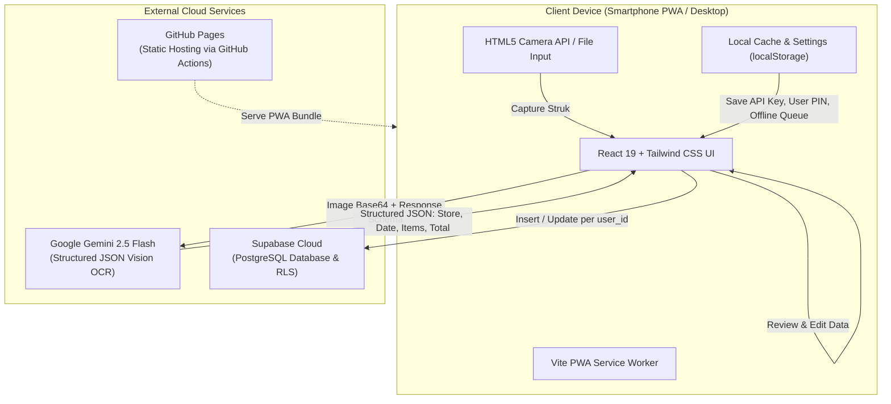

# Design Specification: Daily Expense Tracker (Scan & Manual Entry PWA)

- **Date**: 2026-11-05
- **Status**: Approved for Implementation Plan
- **Target Deployment**: GitHub Pages (Static PWA) + Supabase (PostgreSQL Cloud) + Google Gemini API (Flash Vision OCR)

---

## 1. Overview & Goals

Aplikasi pencatat pengeluaran harian personal yang ringan, responsif (mobile-first), dan dapat di-install sebagai Progressive Web App (PWA) di perangkat smartphone. Aplikasi ini mendukung **2 pengguna (User A dan User B)** dengan ruang pencatatan terisolasi secara privat yang dilindungi oleh 4-digit PIN cepat.

### Fitur Utama
1. **Cara 1: Scan Foto Struk (AI Vision OCR)**:
   - Pengguna memfoto struk (Indomaret, Alfamart, resto, bensin, nota kasir) atau mengunggah dari galeri.
   - Model `gemini-2.5-flash` mengekstrak data struk ke dalam format JSON terstruktur (*merchant*, tanggal, item-item, total harga, kategori).
   - Hasil ekstraksi langsung dimuat ke dalam **Formulir Interaktif yang dapat langsung diedit** sebelum disimpan ke database.
2. **Cara 2: Input Manual Cepat**:
   - Input cepat deskripsi/toko, nominal rupiah (format otomatis `Rp XX.XXX`), pilihan kategori instan 1-klik, tanggal, dan catatan opsional.
3. **Multi-User Terisolasi (2 User)**:
   - Akun User 1 dan User 2 terpisah dengan PIN masing-masing. Data pengeluaran tidak saling tercampur.
4. **Dashboard & Laporan Ringkas**:
   - Total pengeluaran harian dan bulanan, filter rentang tanggal, breakdown per kategori, dan rincian item struk yang dapat di-*expand*.
5. **Ekspor & Mode Offline**:
   - Penyimpanan antrean lokal ketika offline (*offline-first fallback*) dan fitur ekspor data ke format CSV/Excel.
   - Di-deploy secara otomatis ke **GitHub Pages** menggunakan GitHub Actions.

---

## 2. Arsitektur Sistem & Tech Stack



### Rincian Teknologi
* **Core Framework**: React 19, TypeScript, Vite.
* **Styling**: Tailwind CSS v3 / v4 + Lucide React (ikon modern).
* **PWA & Offline**: `vite-plugin-pwa` dengan Service Worker dan manifest untuk instalasi home screen.
* **Database & Cloud Sync**: `@supabase/supabase-js` terhubung ke Supabase Free Tier.
* **AI OCR Engine**: `@google/genai` (atau direct REST client ke endpoint `generateContent`) memanggil model `gemini-2.5-flash` dengan `responseSchema`.
* **Testing Framework**: Vitest + React Testing Library.
* **CI/CD**: GitHub Actions workflow (`.github/workflows/deploy.yml`) untuk build dan deploy ke cabang `gh-pages`.

---

## 3. Data Model & Database Schema

### 3.1 Tabel Supabase: `expenses`
```sql
CREATE TABLE IF NOT EXISTS expenses (
    id UUID PRIMARY KEY DEFAULT gen_random_uuid(),
    user_id VARCHAR(50) NOT NULL,              -- 'user_1' atau 'user_2'
    title VARCHAR(255) NOT NULL,               -- Nama toko / deskripsi
    amount NUMERIC(15, 2) NOT NULL,            -- Nominal total (contoh: 48500.00)
    category VARCHAR(50) NOT NULL,             -- 'Makanan', 'Belanja', 'Transportasi', dll.
    date DATE NOT NULL DEFAULT CURRENT_DATE,   -- YYYY-MM-DD
    receipt_items JSONB DEFAULT NULL,          -- Array: [{ name, quantity, price }]
    notes TEXT DEFAULT NULL,                   -- Catatan opsional
    receipt_image_url TEXT DEFAULT NULL,       -- Opsional path/thumbnail
    created_at TIMESTAMPTZ DEFAULT NOW(),
    updated_at TIMESTAMPTZ DEFAULT NOW()
);

CREATE INDEX IF NOT EXISTS idx_expenses_user_date ON expenses(user_id, date DESC);
```

### 3.2 TypeScript Interfaces (`src/types/index.ts`)
```typescript
export interface ReceiptItem {
  name: string;
  quantity: number;
  price: number;
}

export interface Expense {
  id: string;
  user_id: string;
  title: string;
  amount: number;
  category: ExpenseCategory;
  date: string; // YYYY-MM-DD
  receipt_items?: ReceiptItem[] | null;
  notes?: string | null;
  created_at: string;
  synced?: boolean; // flag status sinkronisasi offline
}

export type ExpenseCategory = 
  | 'Makanan & Minuman'
  | 'Belanja Harian'
  | 'Transportasi & Bensin'
  | 'Tagihan & Utilitas'
  | 'Hiburan & Hobi'
  | 'Kesehatan'
  | 'Lainnya';

export interface UserProfile {
  id: 'user_1' | 'user_2';
  name: string;
  pin: string; // 4-digit PIN
}

export interface GeminiReceiptResponse {
  merchantName: string;
  date: string;
  category: string;
  items: Array<{
    name: string;
    quantity: number;
    price: number;
  }>;
  totalAmount: number;
  confidenceNotes?: string;
}
```

---

## 4. Alur & Logika Bisnis (Core Workflows)

### 4.1 Alur Cara 1: Scan Struk & Edit Instan
1. Pengguna membuka tab **Scan**.
2. Pengguna menekan tombol kamera untuk mengambil foto struk atau memilih dari galeri.
3. Gambar dikompresi di browser (maksimal resolusi 1200px lebar/tinggi, kualitas JPEG 0.8) guna mempercepat unggahan dan menghemat kuota.
4. Client mengirimkan gambar Base64 ke Gemini `gemini-2.5-flash` dengan konfigurasi:
   - `temperature: 0.1` (faktual dan akurat).
   - `responseMimeType: "application/json"`.
   - `responseSchema`: skema strict untuk `merchantName`, `date`, `category`, `items`, dan `totalAmount`.
5. Hasil JSON otomatis memicu pembukaan **Formulir Edit Hasil Scan**:
   - Menampilkan thumbnail struk di bagian atas.
   - Kolom nama toko / transaksi terisi dan bisa diedit.
   - Kolom tanggal otomatis terpilih dan bisa diedit.
   - Dropdown kategori otomatis terpilih sesuai prediksi AI dan bisa diganti.
   - Tabel/daftar item belanjaan menampilkan nama barang, qty, dan harga satuan; user dapat menambah item baru, mengubah nominal, atau menghapus item.
   - Total nominal dapat dihitung otomatis dari subtotal item atau disesuaikan manual.
6. Pengguna menekan tombol **"Simpan Pengeluaran"**.
7. Data disimpan ke Supabase dengan menyertakan `user_id` user yang sedang aktif.

### 4.2 Alur Cara 2: Input Manual Cepat
1. Pengguna membuka tab **Input Manual** (atau tombol "+" di Dashboard).
2. Pengguna mengisi:
   - **Judul/Toko** (contoh: *"Beli Pulsa"*, *"Kopi Kenangan"*).
   - **Nominal** (input angka dengan tampilan format Rupiah otomatis `Rp 25.000`).
   - **Kategori** (pilihan pil 1-klik).
   - **Tanggal** (default hari ini).
   - **Catatan** (opsional).
3. Pengguna menekan **"Simpan Pengeluaran"**.
4. Data langsung masuk ke list harian dan tersimpan di database.

### 4.3 Alur Otentikasi & Penguncian (2 User)
1. Pada sesi pertama kali di perangkat, muncul modal:
   - Pilihan: `[👤 User 1]` atau `[👤 User 2]`.
   - Input 4-digit PIN (default PIN dapat diset pertama kali, misal `1234` atau PIN kustom).
2. Setelah PIN cocok, profil aktif disimpan di `localStorage`.
3. Di sudut kanan atas header terdapat status profil:
   - Menampilkan nama aktif (misal: `User 1`).
   - Tombol ikon gembok `[🔒 Kunci / Ganti Akun]`. Saat ditekan, sesi terkunci dan memerlukan PIN untuk kembali membuka.

---

## 5. Struktur Antarmuka Pengguna (UI/UX)

```text
┌──────────────────────────────────────────┐
│ [🧾 ScanApp]        [🟢 Online] [👤 User 1 🔒] │ <-- Header
├──────────────────────────────────────────┤
│                                          │
│  [ Filter: Hari Ini ▾ ]   [ + Tambah ]   │
│                                          │
│  ┌────────────────────────────────────┐  │
│  │ 💰 Total Pengeluaran Hari Ini      │  │
│  │    Rp 175.500                      │  │
│  │    (4 Transaksi)                   │  │
│  └────────────────────────────────────┘  │
│                                          │
│  Daftar Transaksi:                       │
│  ┌────────────────────────────────────┐  │
│  │ 🛒 Alfamart Kemang      Rp 52.000  │  │
│  │    Belanja Harian • 15:30          │  │
│  │    [▼ Rincian 3 Barang Struk]      │  │
│  └────────────────────────────────────┘  │
│  ┌────────────────────────────────────┐  │
│  │ ☕ Kopi Tuku            Rp 20.000  │  │
│  │    Makanan & Minuman • 11:15       │  │
│  └────────────────────────────────────┘  │
│                                          │
├──────────────────────────────────────────┤
│ [📊 Beranda] [📸 Scan] [✍️ Manual] [⚙️ Setelan] │ <-- Bottom Navigation Bar
└──────────────────────────────────────────┘
```

---

## 6. Penanganan Error & Mode Offline (Resilience)

1. **Gemini API Key Missing**:
   - Jika pengguna belum memasukkan API key, sistem menampilkan banner panduan ramah dengan tombol langsung menuju tab **Setelan**, serta menyediakan link gratis untuk membuat API key di Google AI Studio.
2. **Foto Struk Rusak / Buram / Gagal OCR**:
   - Jika Gemini tidak dapat membaca struk (misal foto blur), sistem menampilkan notifikasi: *"Struk sulit terbaca jelas, silakan lengkapi nominal secara manual"*.
   - Gambar struk tetap ditampilkan sebagai panduan visual di atas form manual agar pengguna tidak perlu bolak-balik galeri.
3. **Koneksi Internet Putus (Offline-First)**:
   - Data disimpan ke dalam antrean lokal `localStorage` key `scanapp_offline_queue`.
   - Indikator koneksi di header berubah menjadi *"🟡 Mode Offline (Tersimpan Lokal)"*.
   - Event listener `window.addEventListener('online', ...)` otomatis melakukan sinkronisasi (*flush queue*) ke Supabase ketika koneksi kembali terhubung.
4. **Validasi Formulir**:
   - Nominal pengeluaran harus berupa angka positif $> 0$.
   - Judul transaksi minimal 2 karakter.
   - Tanggal tidak boleh melebihi tanggal hari ini di masa depan (opsi peringatan).

---

## 7. Rencana Pengujian (Testing Strategy)

### 7.1 Unit Tests (Vitest)
* `src/utils/formatters.test.ts`: Format Rupiah (`formatIDR(15000) === "Rp 15.000"`), format tanggal Indonesia.
* `src/services/gemini.test.ts`: Parsing respons JSON Gemini, penanganan data tidak lengkap/fallback default.
* `src/services/storage.test.ts`: Antrean sinkronisasi offline, enqueue, dequeue, dan persistensi `localStorage`.
* `src/utils/calculations.test.ts`: Agregasi total harian, mingguan, bulanan, dan total per kategori.

### 7.2 Component Tests (React Testing Library)
* `ManualExpenseForm.test.tsx`: Validasi input wajib, pengisian nominal, pemilihan kategori, pemanggilan callback `onSave`.
* `ReceiptReviewModal.test.tsx`: Pengeditan nama toko, penambahan baris item struk, penghapusan item, pembaruan total nominal otomatis.
* `ProfilePinModal.test.tsx`: Pengecekan PIN benar membuka aplikasi, PIN salah memicu pesan error.

### 7.3 Verifikasi Build & PWA
* Menjalankan TypeScript type check: `npx tsc --noEmit`.
* Menjalankan Vite production build: `npm run build`.
* Memverifikasi file `manifest.webmanifest` dan Service Worker ter-generate dengan benar di folder `dist`.

---

## 8. Deployment & CI/CD ke GitHub Pages

File alur kerja GitHub Actions `.github/workflows/deploy.yml`:
```yaml
name: Deploy to GitHub Pages

on:
  push:
    branches: [ main ]
  workflow_dispatch:

permissions:
  contents: read
  pages: write
  id-token: write

concurrency:
  group: "pages"
  cancel-in-progress: true

jobs:
  deploy:
    environment:
      name: github-pages
      url: ${{ steps.deployment.outputs.page_url }}
    runs-on: ubuntu-latest
    steps:
      - name: Checkout
        uses: actions/checkout@v4

      - name: Set up Node.js
        uses: actions/setup-node@v4
        with:
          node-version: 20
          cache: 'npm'

      - name: Install dependencies
        run: npm ci

      - name: Run Tests
        run: npm run test:run

      - name: Build Project
        run: npm run build

      - name: Setup Pages
        uses: actions/configure-pages@v4

      - name: Upload artifact
        uses: actions/upload-pages-artifact@v3
        with:
          path: './dist'

      - name: Deploy to GitHub Pages
        id: deployment
        uses: actions/deploy-pages@v4
```

---

## 9. Kesimpulan & Langkah Selanjutnya

Spesifikasi desain ini telah mencakup seluruh kebutuhan:
1. PWA responsif mobile-first di GitHub Pages.
2. AI OCR struk berbasis Google Gemini 2.5 Flash dengan formulir edit instan.
3. Input manual cepat & intuitif.
4. Sistem 2 user terisolasi dengan 4-digit PIN.
5. Supabase cloud database & antrean offline-first.

Setelah dokumen spesifikasi ini ditinjau, tahap selanjutnya adalah menjalankan skill `writing-plans` untuk menyusun rencana implementasi modular secara bertahap (TDD & Subagent Driven).

